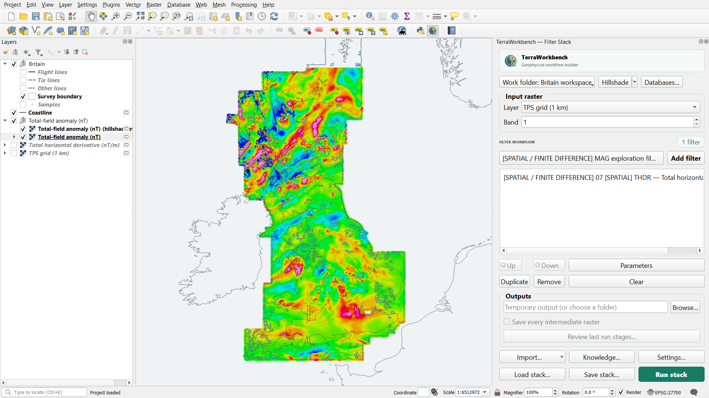

# TerraWorkbench

La Pila de filtros incluye Vista previa en vivo: actualiza una única capa temporal al editar parámetros o mover el mapa, hasta el filtro seleccionado. F6 alterna antes/después. Aplicar procesa toda la pila a resolución nativa y conserva su procedencia. La vista previa usa una ventana ampliada a resolución de pantalla; los filtros de longitud de onda regional pueden diferir del resultado completo.

TerraWorkbench declara GeoRamp como dependencia QGIS para ajustar interactivamente paletas científicas, colores e histogramas. El botón Ajustar colores (GeoRamp) abre la capa de vista previa o la entrada. Si falta GeoRamp, Instalar GeoRamp abre el gestor de complementos; el procesamiento sigue disponible. La instalación desde ZIP puede requerir instalar GeoRamp por separado.

Añade marcas de graduación a los ejes del visor de perfiles. Mejora la robustez de la interpolación y avisa cuando la escala de la grilla solicitada no es adecuada para mínima curvatura. Corrige el cálculo de IGRF y tilt. Conserva por defecto el nivel medio en la reducción al polo (RTP), también en la vista previa. Incorpora la vista previa en vivo de la pila de filtros y recomienda GeoRamp para las rampas de color.

GeoRamp es un plugin de QGIS del mismo autor y se recomienda para las rampas de color. [GeoRamp](https://plugins.qgis.org/plugins/georamp/) · [CHANGELOG.es.md](CHANGELOG.es.md)

<a href="README.md">English</a> · <strong>Español</strong> · <a href="README.pt.md">Português</a>

TerraWorkbench es un entorno abierto en QGIS para gestionar levantamientos geofísicos, procesar sus datos e invertirlos. Su motor Python, <code>terraworkbench_core</code>, también funciona sin QGIS; algunos flujos aún requieren adaptadores QGIS/GDAL o dependencias científicas opcionales.

Gran Bretaña, grilla local por spline de placa delgada (TPS) de 1 km → derivada horizontal total (nT/m). Datos de [Uieda (2022)](https://doi.org/10.5281/zenodo.5879260) ([CC BY 4.0](https://creativecommons.org/licenses/by/4.0/)), con materiales del British Geological Survey © UKRI 2021 bajo la [Open Government Licence](https://www.nationalarchives.gov.uk/doc/open-government-licence/version/3/). Costa de [Natural Earth](https://www.naturalearthdata.com/downloads/10m-physical-vectors/10m-coastline/). [Simbología con GeoRamp](https://github.com/jordan-zav/GeoRamp). [Generador](docs/assets/generate_readme_hero.py) · [Parámetros y hashes](docs/assets/readme-hero-record.json).

## Funciones clave

### Bases de levantamientos

Organiza levantamientos desde **Raster → TerraWorkbench → Survey databases…**: catálogo SQLite, canales Parquet inmutables, versiones de canales y linaje exacto de versiones de entrada. Importa texto revisado o Parquet plano, lee canales seleccionados, calcula derivados, exporta CSV y crea capas de puntos QGIS. Los originales permanecen intactos. Es una implementación para proyectos locales: no incluye borrado destructivo de canales, editor de celdas ni interfaz para restaurar versiones, ni certificación de rendimiento a escala de campo. Consulta [workspaces de levantamientos](docs/guides/survey_workspaces.md).

### Procesamiento

| Área | Flujos incluidos |
| --- | --- |
| Realce magnético | Derivadas horizontales/verticales, señal analítica, THDR, tilt, TDX, theta y gradientes direccionales |
| Realce gravimétrico | Derivadas, continuación, separación regional/residual y amplitud de gradiente total |
| Reducción gravimétrica | GRS80, perturbación, aire libre, Bullard B, Bouguer, terreno con DEM y residual isostático Airy |
| Procesamiento espectral | Butterworth, filtros ideales, coseno, coseno direccional, continuación e integración |
| Corrección de campo | RTP, RTE, transformación fuente-destino e IGRF-14 |
| Espectrometría gamma | Productos K/eU/eTh, ternarios, dosis, QC y correcciones calibradas de cuentas crudas |
| Preparación de levantamientos | Importación, QC de vuelo/base/lag/rumbo, líneas repetidas, nivelación de cruces, mallado y micronivelación |
| Interpolación física | Fuentes equivalentes de Harmonica y predicción a altura relativa declarada |
| Automatización | Processing, lotes, Modelador y recetas JSON reutilizables de Filter Stack |

El procesamiento básico incluye TPS global hasta 2.000 puntos únicos, aproximación TPS explícitamente local para entradas mayores, suavizado binomial de nueve puntos y control automático de ganancia por RMS local. Consulta [alcance y límites](docs/guides/basic_processing_migration.md).

#### Entradas de levantamiento compatibles

| Entrada | Soporte y límites |
| --- | --- |
| Geosoft binario <code>.GRD</code> | Lector nativo; recupera CRS y metadatos de título/fecha/XML disponibles |
| GeoTIFF, GXF, AAIGrid y XYZ regular | GDAL; conversión a GeoTIFF preparado para análisis |
| Malla regular CSV/ASCII X-Y-valor | Exige malla completa regular; no interpola puntos irregulares silenciosamente |
| Capas de puntos | IDW, vecino próximo, TPS global/local y mínima curvatura experimental |
| Esri FileGDB | Rásteres, clases de entidades y tablas mediante GDAL/OGR |
| Geosoft <code>.gdb</code> de un archivo | Runtime BSD GX Developer opcional, solo Windows, para inventario/exportación a CSV abierto y capas QGIS |

Una base de canales Geosoft no es una Esri FileGDB. El puente opcional no modifica levantamientos originales ni incorpora código Geosoft al paquete.

En Windows, la conversión de GDB requiere Seequent Connect y una cuenta Seequent ID gratuita. El administrador de dependencias solicita autorización antes de descargar GX 2024.2 completo (unos 345 MiB). Si falta .NET 6, instale [Microsoft .NET 6 Desktop Runtime x64](https://dotnet.microsoft.com/en-us/download/dotnet/6.0), que incluye los frameworks de escritorio y núcleo. Si una cuenta de organización muestra el checkout, seleccione While app is running. La reserva termina al cerrar GX. Para trabajar sin una cuenta Seequent, importe XYZ o CSV. [GDB](docs/development/gdb_open_archive.md).

<strong>Magnetic and gravity exploration filters</strong>

### Magnetic filters

- DX and DY first horizontal derivatives
- DZ first and DZ2 second vertical derivatives
- Configurable upward continuation and residual enhancement
- THDR total horizontal derivative and tilt angle
- Directional horizontal gradient with configurable azimuth
- AS / ASA analytic signal amplitude
- TDX horizontal tilt angle and theta angle map

### Gravity filters

- DX and DY first horizontal derivatives
- DZ first and DZ2 second vertical derivatives
- Configurable upward continuation
- Gaussian regional field and residual field
- THDR total horizontal derivative
- Tilt angle and total gradient amplitude

### Gravity corrections and anomalies

- GRS80 normal gravity and latitude-corrected gravity disturbance
- Linear free-air correction and free-air anomaly from observed gravity plus geometric elevation
- Infinite-plate Bouguer effect and simple Bouguer anomaly
- Bullard-B Earth-curvature correction for land elevations
- DEM rectangular-prism terrain correction with an explicit computation guard
- Complete land Bouguer anomaly: <code>observed - GRS80 + free-air - plate + terrain - Bullard B</code>
- Airy Moho-depth model and [regional isostatic residuals](docs/reference/methods/isostasy.md), with finite-prism and explicitly periodic FFT models

Observed gravity must be calibrated. Moving-platform points can use the explicit
survey-wide drift, external-tide and Eötvös correction tool before gridding; an
already reduced grid must not be corrected twice. Elevations must be geometric heights referenced to the ellipsoid and
aligned reduction rasters must share the same CRS, extent and pixel grid. Airy
uses a common vertical datum for model and stations, with an optional independent
regional grid in the same metric CRS. Station NoData is preserved; regional load
gaps are rejected. Direct forward modelling scales with station/prism pairs, so
the tools enforce a configurable safety limit and should use a defensible regional
resolution. The DEM/model extent is the outer correction boundary; inspect edges
and run density, depth and resolution sensitivity tests.

Canonical Processing IDs describe configurable operations:
<code>mag_directional_horizontal_gradient</code>, <code>mag_upward_continuation</code> and
<code>grav_upward_continuation</code>. Gradient azimuth and continuation distance are
configurable parameters and are not encoded as fixed values in their IDs.

<strong>Gamma-ray spectrometry and radiometric products</strong>

TerraWorkbench separates products made from calibrated concentration grids from
corrections applied to raw window count rates.

- configurable ratios between any aligned channels, including eTh/K, eU/K and eU/eTh;
- K-red, eTh-green, eU-blue ternary images with percentile stretch and optional normalization;
- terrestrial absorbed dose rate from K (%), eU (ppm) and eTh (ppm), with visible coefficients;
- interpretive <code>F = K × eU / eTh</code> product with denominator protection;
- JSON channel QC with missing, negative and robust distribution statistics;
- non-paralyzable detector dead-time correction;
- explicit aircraft, cosmic and atmospheric-radon background subtraction;
- exponential terrain-clearance normalization to a reference height;
- count-rate sensitivity calibration;
- three-window spectral stripping through a user-supplied response matrix.
- a pre-gridding point-channel chain that preserves raw fields and appends corrected cps, K, eU, eTh, dose and validity.

Raw corrections are not presets. Their coefficients must come from the detector
calibration and survey processing report. Already corrected public grids should
start at the product/QC tools rather than repeat acquisition corrections.
All multi-channel tools require identical CRS, extent, dimensions and pixel grid.
Line leveling, gridding and microleveling remain reusable for radiometric channels.

<strong>RTP, RTE and IGRF-14 magnetic transforms</strong>

- Reduction to the pole with automatic IGRF-14 or manual field direction
- Reduction to the equator
- General source-to-target magnetic field-direction transform
- Survey date recovered from imported metadata with manual override
- Optional remanent magnetization direction
- Explicit maximum-gain stabilization cap

Automatic mode evaluates IGRF-14 at the raster center, survey date and
observation altitude using <code>ppigrf</code>. Inclination is positive downward and
declination is clockwise from geographic North. RTP and RTE can be
ill-conditioned at low magnetic latitudes, so stabilization and result review
are required.

The Filter Stack groups RTP, RTE and the general field-direction transform under
**MAG field-direction transforms**. These operations use a two-dimensional FFT:
the raster is transformed from map space into spatial-frequency/wavenumber space,
the transfer function is applied there, and an inverse FFT returns a spatial
GeoTIFF. "FFT" describes the numerical domain, not a different kind of output.

<strong>FFT spectral processing and Filter Stack</strong>

TerraWorkbench exposes the numerical domain instead of treating every grid
operation as the same kind of filter. Algorithm labels use:

- **SPATIAL / FINITE DIFFERENCE** for cell-neighbour derivatives such as the
  default DX and DY exploration products
- **FREQUENCY / FOURIER** for transformations executed by a two-dimensional FFT
- **MIXED / SPATIAL + FREQUENCY** for products such as Tilt or analytic signal that combine
  spatial horizontal derivatives with an FFT vertical derivative
- **PHYSICAL MODEL / SPATIAL GRID** for Bouguer, terrain and gravity-reduction physics
- **SPATIAL / CELLWISE GRID** for independent transformations of aligned cells

The frequency-domain engine removes a mean or plane, reflect-pads the grid, applies a
cosine taper across only the padded margin, multiplies compatible transfer
operators on one forward 2D FFT, performs inverse transforms for requested
outputs, crops to the original footprint and optionally restores the trend.
Preprocessing parameters are stored with every stack recipe.

- Butterworth low-pass, high-pass, band-pass and notch
- FFT easting, northing and upward derivatives, orders 1–5
- Ideal band-pass and band-reject with an explicit ringing warning
- Cosine roll-off low-pass and high-pass
- Directional cosine pass and reject with configurable strike azimuth and degree
- Stabilized downward continuation with Butterworth taper and maximum-gain cap
- Horizontal integration in easting and northing, and vertical integration
- Magnetic pseudogravity from a phase-corrected RTP/RTE grid, with explicit interpretive scaling

The dockable Filter Stack feeds each output into the next filter. Steps can be
edited, reordered, duplicated and saved as JSON recipes. Results may remain
temporary or be written as a final GeoTIFF with every intermediate raster.

Wavelengths, continuation distances and pixel spacing use the raster CRS units.
FFT tools require an evenly spaced north-up raster in a projected CRS with no
NoData or non-finite cells.

<strong>Line QC, gridding and microleveling</strong>

**Crossover QC and tie-line leveling** operates on QGIS point layers. It builds
traverse and tie trajectories, interpolates measurements at crossings, rejects
robust MAD outliers and solves zero-mean constant, linear or damped quadratic
corrections for each connected line. Outputs preserve raw values and include corrected points,
crossover residuals, line corrections and RMS before/after.

**Magnetic preprocessing** can audit sample interval, spacing, speed, true-north
heading, turns, terrain clearance and channel rate without deleting data. It
removes IGRF-14 total intensity independently at every valid point after
base/lag/heading correction, and compares repeated lines by indexed spatial matches with
an optional robust median offset. Raw fields remain unchanged and every result
includes explicit correction, residual and validity fields.

Advanced acquisition QC estimates channel lag with a complete correlation curve,
audits magnetic base-station gaps/spikes/rate/drift (including midnight rollover),
detects anomalous inter-line spacing and likely missing lines, and samples a DEM
to verify drape/terrain clearance. Storm classification is deliberately excluded
unless an external geomagnetic index is supplied; DEM and platform heights must
share a vertical datum.

**Survey point gridding** supports a projected output CRS, density-based or
explicit cell size, IDW, nearest neighbor, global/local TPS and experimental
multilevel minimum curvature. Minimum curvature uses Briggs off-node constraints,
reports convergence and separates the initialization search radius from output
blanking. Its final domain does not inherit asymmetric coarse-grid rounding.
Windowed sinc interpolation requires a regular sample lattice and also supports
raster expansion; it does not directly grid irregular GPS points or increase
measured resolution. See [interpolation methods](docs/reference/methods/interpolation_methods.md)
for parameter semantics and limitations.

**Directional microleveling** estimates short across-line corrugation while
retaining longer along-line wavelengths. Both the corrected grid and removed
component are written for audit.

### Inversión 3D

SimPEG permite inversión acotada de contraste de densidad, susceptibilidad escalar y gravedad–magnetismo conjunta con gradiente cruzado. MVI admite coordenadas cartesianas y esféricas por etapas mediante la API pública <code>terraworkbench_core.inversion.run_potential_field_inversion</code>, con <code>kind="mvi"</code> y <code>mvi_parameterization="spherical"</code>; consulta el [contrato MVI esférico](docs/reference/methods/spherical_mvi.md). Una implementación numérica no demuestra por sí sola recuperación geológica.

<strong>Entradas, salidas y límites de inversión</strong>

Los flujos aceptan observaciones proyectadas, incertidumbres, elevación de receptores y topografía opcional. Admiten TensorMesh y TreeMesh refinada por observaciones/topografía, núcleos integrales Choclo, sensibilidades en disco, límites de celdas activas y cancelación entre iteraciones. Densidad y susceptibilidad escalar exponen controles Lp/IRLS y un modelo de referencia acotado. MVI esférico tiene controles de amplitud/ángulos y validación separados.

Las coordenadas deben estar proyectadas en metros; la declinación magnética geográfica se convierte a ejes de malla mediante convergencia meridiana. Las salidas incluyen VTK, NPZ, QC JSON y CSV observado/predicho/residual. La inversión no es única: evalúa tamaño de celda, profundidad del dominio, incertidumbres, cotas, topografía, campo inductor, regularización y pesos de acoplamiento.

### Core independiente

Instalable como <code>terraworkbench-core</code>, contiene núcleos numéricos y API de almacenamiento/flujos sin importar QGIS ni Qt. El plugin incorpora la misma implementación. Aún no reemplaza de forma independiente todos los flujos de Processing; la exportación GDAL nativa y parte de la orquestación del host siguen separadas. Consulta [alcance del Core](docs/development/scientific_core.md).

### Idiomas de documentación e interfaz

Los manuales y la interfaz están disponibles en inglés, español y portugués. **Settings / Configuración** cambia la interfaz y el catálogo Processing sin reiniciar QGIS, y guarda valores de flujo, carga de resultados, ayudas científicas, ruta Geosoft opcional y acceso a dependencias/ejemplos. **Knowledge** abre la biblioteca local de capítulos.

## Instalación

La primera instalación de dependencias puede tardar unos 10 minutos, según la conexión y las cachés disponibles.

### Plugin de QGIS

Desde una copia del repositorio, genera el ZIP con el empaquetador de lista explícita:

~~~sh
python scripts/package_plugin.py
~~~

Valida fuentes/metadatos y crea <code>dist/TerraWorkbench-1.1.0.zip</code>. En QGIS, abre **Plugins → Manage and Install Plugins → Install from ZIP** y selecciona ese archivo. La alternativa interactiva Windows es <code>scripts/build_dist.bat</code>; pide una versión, por lo que debes conservar la actual si solo empaquetas.

El instalador Windows actual comprueba la detección y después instala/actualiza el perfil activo:

~~~bat
scripts/install_update_open_qgis.bat --check
scripts/install_update_open_qgis.bat
~~~

Usa <code>--no-launch</code> para evitar abrir QGIS. Define <code>QGIS_ROOT</code> solo si la detección no selecciona la instalación deseada.

Los metadatos declaran QGIS 3.28–3.x. El contrato de dependencias 2D es [requirements/base.txt](requirements/base.txt); no fija un mínimo global de Python para todas las combinaciones de paquetes. El Core independiente declara Python ≥3.10. La inversión exige Python de QGIS/independiente ≥3.11 y la pila opcional de [requirements/inversion.txt](requirements/inversion.txt): SimPEG 0.25, discretize 0.12 y Choclo 0.3.

El gestor integrado lee esos archivos, instala solo con aprobación explícita en una carpeta propia del perfil QGIS y conserva la precedencia de paquetes del host. Los paquetes 3D opcionales están separados del flujo 2D. Reinicia QGIS tras instalar o reparar dependencias; la compatibilidad de bibliotecas nativas sigue dependiendo del entorno del host.

### Core con pip

Desde la raíz del repositorio, usa Python ≥3.10 con NumPy/SciPy declarados en <code>pyproject.toml</code>. El wheel independiente no incluye ejemplos ni componentes QGIS; ejecuta el inicio rápido desde la copia del repositorio.

~~~sh
python -m pip install .
~~~

Para inversión, usa primero Python ≥3.11 e instala <code>python -m pip install ".[inversion]"</code>. Otros extras, como <code>storage</code>, <code>prisms</code> y <code>coordinates</code>, están declarados en <code>pyproject.toml</code>. Instalar Core no instala QGIS ni un entorno GDAL nativo completo.

### Linux y macOS

El plugin está probado en Windows. El plugin completo no está probado en Linux ni macOS; la [validación de inversión](docs/validation/reports/inversion3d_extensions.md) registra CI en Linux en revisiones identificadas.

## Inicio rápido

### QGIS

1. En TerraWorkbench, elige **Import… → Bundled sample datasets** y carga <code>synthetic_magnetic_anomaly.tif</code>.
2. Abre **Filter Stack**, agrega una derivada magnética como DX, ejecútala y revisa el ráster; guarda la receta JSON si lo necesitas.
3. Abre **Raster → TerraWorkbench → Survey databases…**, crea un workspace en una carpeta nueva vacía e importa <code>sample_data/synthetic/synthetic_survey_points.csv</code> mediante el asistente de revisión. Confirma canales, unidades y CRS explícitamente.

Los ejemplos incluidos son datos sintéticos educativos pequeños en EPSG:32718, bajo CC0-1.0; no son observaciones de campo ni evidencia geológica. La [captura existente de Filter Stack](docs/assets/filter-stack.png) ilustra la interfaz. Los originales locales de terceros siguen excluidos de los paquetes salvo que se acrediten derechos de redistribución.

### Python

Desde la raíz del repositorio, lee una línea sintética incluida y aplica una media centrada de cinco muestras con Core independiente. Cuatro muestras de borde quedan indefinidas porque el filtro exige ventanas completas:

~~~python
from pathlib import Path
import numpy as np
from terraworkbench_core.channel_filters import ChannelFilterOptions, filter_segment

path = Path("sample_data/synthetic/synthetic_survey_points.csv")
data = np.genfromtxt(path, delimiter=",", names=True, dtype=None, encoding="utf-8")
line = data[data["line_id"] == data["line_id"][0]]
options = ChannelFilterOptions(method="mean", window=5)
filtered, diagnostics = filter_segment(np.arange(line.size), line["magnetic_nt"], options)
print("samples:", line.size, "finite filtered:", np.isfinite(filtered).sum())
~~~

## Reproducir los benchmarks públicos

Sigue la [guía de procesamiento](docs/validation/reports/public_processing_benchmark.md) y la [guía de inversión](docs/validation/reports/public_inversion_benchmark.md), con sus catálogos de entradas fijadas y criterios numéricos declarados. Elige explícitamente la caché y una carpeta nueva de salida; por ejemplo, <code>python scripts/benchmark_public_processing.py --cache CARPETA_CACHE --output NUEVA_SALIDA</code>. Conserva fallos y limitaciones. Repetir datos conocidos no es una validación ciega nueva ni garantiza identidad de coma flotante entre plataformas. Los materiales editoriales del estudio permanecen en el archivo de desarrollo y no son necesarios para usar el plugin público.

## Documentación

- [Manual inglés](docs/manuals/en/README.md), [manual español](docs/manuals/es/README.md), [manual portugués](docs/manuals/pt/README.md) y [vista general](docs/manuals/README.md).
- [Handbook y base de conocimiento](docs/handbook/README.md).
- [Índice de documentación](docs/README.md) y [estructura del repositorio](docs/development/repository_structure.md).

## Validación y límites

Empieza por [evidencia de validación](docs/validation/README.md) y el [informe de referencia/recuperación MVI](docs/validation/reports/mvi_reference_validation.md). La [validación MVI esférica](docs/reference/methods/spherical_mvi.md) es separada y no elimina los fallos de benchmarks cartesianos. La inversión no es única; los resultados de recuperación, incluidos los criterios fallidos, están documentados. Un buen ajuste no establece profundidad, volumen o dirección de magnetización únicos.

Los requisitos y límites científicos permanecen en los desplegables de procesamiento: FFT exige ráster regular, proyectado y orientado al norte, sin NoData/no finitos; la estabilización RTP/RTE, calibración instrumental, coherencia de datums verticales y sensibilidad a bordes de corrección requieren revisión. La concordancia con referencias independientes se limita a los casos registrados, sin equivalencia universal.

## Cómo citar

Usa [CITATION.cff](CITATION.cff) para citar el software y registra la revisión exacta utilizada. DOI archivístico del software para todas las versiones: [10.5281/zenodo.24119093](https://doi.org/10.5281/zenodo.24119093); cada versión tiene además su DOI propio en Zenodo (1.0.0: [10.5281/zenodo.24119094](https://doi.org/10.5281/zenodo.24119094)). El archivo deja como comentarios los identificadores aún sin asignar, como el ORCID.

## Contribuir

Consulta [CONTRIBUTING.md](CONTRIBUTING.md) para reportar problemas, ejecutar pruebas y Ruff, y respetar la separación Core/plugin. Responsable: Jordan Zavaleta (GisGeo Dev), [jordanzav@gisgeo.dev](mailto:jordanzav@gisgeo.dev).

## Licencia y software de terceros

TerraWorkbench usa [GPL-3.0-or-later](LICENSE). Las bibliotecas de terceros conservan sus licencias; consulta [avisos de terceros](docs/legal/THIRD_PARTY_LICENSES.md). Es un proyecto comunitario independiente, no un producto oficial de QGIS, Fatiando a Terra o SimPEG. Copyright © Jordan Zavaleta.

## Estado del proyecto

El plugin **1.1.0** es el candidato preparado localmente, pendiente de autorización para publicar; el paquete Core independiente es **0.1.0**. Los métodos documentados como experimentales conservan esa condición.

La [campaña pública de procesamiento](docs/validation/reports/public_processing_benchmark.md) registra entradas fijadas y referencias numéricas independientes; los [informes de inversión](docs/validation/README.md) distinguen ejecución, convergencia y recuperación. Las comprobaciones históricas de QGIS 3.44, Processing/Filter Stack y estructura ZIP son evidencia de sus revisiones registradas.

Antes de publicar oficialmente en QGIS quedan validación y envío al repositorio, el aviso de publicación NRCan pendiente y comparaciones científicas independientes más amplias. Interfaces, parámetros y formatos guardados pueden cambiar antes de una release pública.

## Desinstalación completa

Primero abre el gestor de dependencias de TerraWorkbench y pulsa **Eliminar dependencias y preferencias**. Revisa la carpeta exacta del perfil activo, el número de archivos, los bytes totales y las claves; después confirma. Reinicia QGIS como se indica; si el complemento sigue instalado, pedirá reinstalar las dependencias. Para desinstalar completamente, elimina TerraWorkbench desde **Administrar e instalar complementos** de QGIS después de la limpieza.

Alternativa manual: cierra QGIS y elimina únicamente <code>PERFIL_ACTIVO/python/dependencies/TerraWorkbench/PYTHON_MAJOR.MINOR</code>, usando el perfil que informa QGIS, incluida una raíz de perfiles personalizada. Elimina solo las claves bajo <code>TerraWorkbench/</code> de la configuración QSettings de ese perfil: defaultOutputDirectory, keepIntermediate, defaultBand, openInspectorAfterAdd, confirmClearStack, addFinalResultToProject, showScientificTooltips, geosoftLocation, localTestDataDirectory, language, dependencyDialogVersion y surveyWorkspace. Revisa cualquier clave adicional del mismo espacio. Conserva otros perfiles, versiones de Python y complementos. La acción automática rechaza enlaces y uniones; nunca borra al ejecutar unload ni al desactivar el complemento. En Windows, las DLL cargadas pueden impedir el borrado; deja de usar el complemento, reinicia QGIS y aplica la alternativa manual si hace falta.

Oasis montaj, Geosoft y Seequent son marcas de sus respectivos titulares. TerraWorkbench no está afiliado a ellos ni cuenta con su respaldo.
