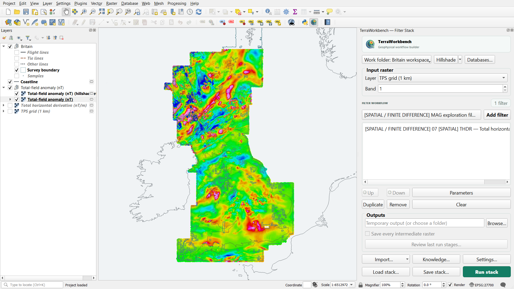

# TerraWorkbench

The Filter Stack includes Live preview: editing parameters or moving the map updates a single temporary layer through the selected filter. F6 toggles before/after. Apply runs the whole stack at native resolution and records provenance. Preview uses an expanded screen-resolution window; regional wavelength filters can differ from the full result.

TerraWorkbench declares GeoRamp as a QGIS dependency for interactive scientific palettes, colours and histograms. Adjust colours (GeoRamp) opens the preview or input layer. When unavailable, Install GeoRamp opens the plugin manager and processing remains available. ZIP installations may need GeoRamp installed separately.

Adds axis tick marks to the profile viewer. Improves gridding robustness and warns when the requested grid scale is unsuitable for minimum curvature. Corrects IGRF and tilt processing. Preserves the mean by default in reduction to the pole (RTP), including the live filter preview. Adds live previews for the filter stack and recommends GeoRamp for color ramps.

GeoRamp is a QGIS plugin by the same author and is recommended for color ramps. [GeoRamp](https://plugins.qgis.org/plugins/georamp/) · [CHANGELOG.md](CHANGELOG.md)

<strong>English</strong> · <a href="README.es.md">Español</a> · <a href="README.pt.md">Português</a>

TerraWorkbench is an open-source QGIS environment for managing geophysical surveys, processing their data and running inversions. Its Python engine, <code>terraworkbench_core</code>, also runs without QGIS; some workflows still require QGIS/GDAL adapters or optional scientific dependencies.

Great Britain, 1 km local thin-plate spline (TPS) grid → total horizontal derivative (nT/m). Data from [Uieda (2022)](https://doi.org/10.5281/zenodo.5879260) ([CC BY 4.0](https://creativecommons.org/licenses/by/4.0/)), including British Geological Survey materials © UKRI 2021 under the [Open Government Licence](https://www.nationalarchives.gov.uk/doc/open-government-licence/version/3/). Coastline by [Natural Earth](https://www.naturalearthdata.com/downloads/10m-physical-vectors/10m-coastline/). [Map styled with GeoRamp](https://github.com/jordan-zav/GeoRamp). [Generator](docs/assets/generate_readme_hero.py) · [Parameters and hashes](docs/assets/readme-hero-record.json).

## Key features

### Survey databases

Organize surveys through **Raster → TerraWorkbench → Survey databases…**: a SQLite catalogue, immutable Parquet channels, channel versions and exact input-version lineage. Import reviewed text or flat Parquet, read selected channels, calculate derived channels, export CSV and create QGIS point layers. Original source files remain unchanged. This is a local-project implementation: there is no destructive channel deletion, in-place cell editor or version-restoration GUI, and no field-scale performance certification. See [survey workspaces](docs/guides/survey_workspaces.md).

### Processing

| Area | Included workflows |
| --- | --- |
| Magnetic enhancement | Horizontal/vertical derivatives, analytic signal, THDR, tilt, TDX, theta and directional gradients |
| Gravity enhancement | Derivatives, continuation, regional/residual separation and total gradient amplitude |
| Gravity reduction | GRS80, gravity disturbance, free-air, Bullard B, Bouguer, DEM terrain and Airy isostatic residual |
| Spectral processing | Butterworth, ideal, cosine roll-off, directional cosine, continuation and integration |
| Field corrections | RTP, RTE, source-to-target transform and IGRF-14 |
| Gamma-ray spectrometry | K/eU/eTh products, ternaries, dose, QC and calibrated raw-count corrections |
| Survey preparation | Import, flight/base/lag/heading QC, repeat lines, crossover leveling, gridding and microleveling |
| Physical interpolation | Harmonica equivalent sources and prediction at a declared relative height |
| Automation | Processing, batch jobs, Model Designer and reusable JSON Filter Stack recipes |

Basic processing also includes global TPS gridding for up to 2,000 unique points, an explicitly local TPS approximation for larger inputs, nine-point binomial smoothing and local-RMS automatic gain control. See [scope and limitations](docs/guides/basic_processing_migration.md).

#### Supported survey inputs

| Input | Support and limits |
| --- | --- |
| Geosoft binary <code>.GRD</code> | Native reader; recovers CRS and available title/date/XML metadata |
| GeoTIFF, GXF, AAIGrid and regular XYZ | GDAL; converted to analysis-ready GeoTIFF |
| CSV/ASCII regular X-Y-value grid | Complete regular grid required; no silent interpolation of irregular points |
| Survey point layers | IDW, nearest neighbour, global/local TPS and experimental minimum curvature |
| Esri FileGDB | GDAL/OGR raster, feature-class and table support |
| Geosoft single-file <code>.gdb</code> | Optional Windows-only BSD GX Developer runtime for inventory/export to open CSV and QGIS layers |

A Geosoft channel database is not an Esri FileGDB. The optional bridge does not modify original surveys or bundle Geosoft code.

On Windows, GDB conversion requires Seequent Connect and a free Seequent ID account. The dependency manager asks for consent before downloading the full GX 2024.2 runtime (about 345 MiB). If .NET 6 is missing, install [Microsoft .NET 6 Desktop Runtime x64](https://dotnet.microsoft.com/en-us/download/dotnet/6.0), which includes the desktop and core frameworks. If an organization account prompts for checkout, select While app is running. The checkout ends when GX closes. To work without a Seequent account, import XYZ or CSV. [GDB](docs/development/gdb_open_archive.md).

<strong>Magnetic and gravity exploration filters</strong>

### Magnetic filters

- DX and DY first horizontal derivatives
- DZ first and DZ2 second vertical derivatives
- Configurable upward continuation and residual enhancement
- THDR total horizontal derivative and tilt angle
- Directional horizontal gradient with configurable azimuth
- AS / ASA analytic signal amplitude
- TDX horizontal tilt angle and theta angle map

### Gravity filters

- DX and DY first horizontal derivatives
- DZ first and DZ2 second vertical derivatives
- Configurable upward continuation
- Gaussian regional field and residual field
- THDR total horizontal derivative
- Tilt angle and total gradient amplitude

### Gravity corrections and anomalies

- GRS80 normal gravity and latitude-corrected gravity disturbance
- Linear free-air correction and free-air anomaly from observed gravity plus geometric elevation
- Infinite-plate Bouguer effect and simple Bouguer anomaly
- Bullard-B Earth-curvature correction for land elevations
- DEM rectangular-prism terrain correction with an explicit computation guard
- Complete land Bouguer anomaly: <code>observed - GRS80 + free-air - plate + terrain - Bullard B</code>
- Airy Moho-depth model and [regional isostatic residuals](docs/reference/methods/isostasy.md), with finite-prism and explicitly periodic FFT models

Observed gravity must be calibrated. Moving-platform points can use the explicit
survey-wide drift, external-tide and Eötvös correction tool before gridding; an
already reduced grid must not be corrected twice. Elevations must be geometric heights referenced to the ellipsoid and
aligned reduction rasters must share the same CRS, extent and pixel grid. Airy
uses a common vertical datum for model and stations, with an optional independent
regional grid in the same metric CRS. Station NoData is preserved; regional load
gaps are rejected. Direct forward modelling scales with station/prism pairs, so
the tools enforce a configurable safety limit and should use a defensible regional
resolution. The DEM/model extent is the outer correction boundary; inspect edges
and run density, depth and resolution sensitivity tests.

Canonical Processing IDs describe configurable operations:
<code>mag_directional_horizontal_gradient</code>, <code>mag_upward_continuation</code> and
<code>grav_upward_continuation</code>. Gradient azimuth and continuation distance are
configurable parameters and are not encoded as fixed values in their IDs.

<strong>Gamma-ray spectrometry and radiometric products</strong>

TerraWorkbench separates products made from calibrated concentration grids from
corrections applied to raw window count rates.

- configurable ratios between any aligned channels, including eTh/K, eU/K and eU/eTh;
- K-red, eTh-green, eU-blue ternary images with percentile stretch and optional normalization;
- terrestrial absorbed dose rate from K (%), eU (ppm) and eTh (ppm), with visible coefficients;
- interpretive <code>F = K × eU / eTh</code> product with denominator protection;
- JSON channel QC with missing, negative and robust distribution statistics;
- non-paralyzable detector dead-time correction;
- explicit aircraft, cosmic and atmospheric-radon background subtraction;
- exponential terrain-clearance normalization to a reference height;
- count-rate sensitivity calibration;
- three-window spectral stripping through a user-supplied response matrix.
- a pre-gridding point-channel chain that preserves raw fields and appends corrected cps, K, eU, eTh, dose and validity.

Raw corrections are not presets. Their coefficients must come from the detector
calibration and survey processing report. Already corrected public grids should
start at the product/QC tools rather than repeat acquisition corrections.
All multi-channel tools require identical CRS, extent, dimensions and pixel grid.
Line leveling, gridding and microleveling remain reusable for radiometric channels.

<strong>RTP, RTE and IGRF-14 magnetic transforms</strong>

- Reduction to the pole with automatic IGRF-14 or manual field direction
- Reduction to the equator
- General source-to-target magnetic field-direction transform
- Survey date recovered from imported metadata with manual override
- Optional remanent magnetization direction
- Explicit maximum-gain stabilization cap

Automatic mode evaluates IGRF-14 at the raster center, survey date and
observation altitude using <code>ppigrf</code>. Inclination is positive downward and
declination is clockwise from geographic North. RTP and RTE can be
ill-conditioned at low magnetic latitudes, so stabilization and result review
are required.

The Filter Stack groups RTP, RTE and the general field-direction transform under
**MAG field-direction transforms**. These operations use a two-dimensional FFT:
the raster is transformed from map space into spatial-frequency/wavenumber space,
the transfer function is applied there, and an inverse FFT returns a spatial
GeoTIFF. "FFT" describes the numerical domain, not a different kind of output.

<strong>FFT spectral processing and Filter Stack</strong>

TerraWorkbench exposes the numerical domain instead of treating every grid
operation as the same kind of filter. Algorithm labels use:

- **SPATIAL / FINITE DIFFERENCE** for cell-neighbour derivatives such as the
  default DX and DY exploration products
- **FREQUENCY / FOURIER** for transformations executed by a two-dimensional FFT
- **MIXED / SPATIAL + FREQUENCY** for products such as Tilt or analytic signal that combine
  spatial horizontal derivatives with an FFT vertical derivative
- **PHYSICAL MODEL / SPATIAL GRID** for Bouguer, terrain and gravity-reduction physics
- **SPATIAL / CELLWISE GRID** for independent transformations of aligned cells

The frequency-domain engine removes a mean or plane, reflect-pads the grid, applies a
cosine taper across only the padded margin, multiplies compatible transfer
operators on one forward 2D FFT, performs inverse transforms for requested
outputs, crops to the original footprint and optionally restores the trend.
Preprocessing parameters are stored with every stack recipe.

- Butterworth low-pass, high-pass, band-pass and notch
- FFT easting, northing and upward derivatives, orders 1–5
- Ideal band-pass and band-reject with an explicit ringing warning
- Cosine roll-off low-pass and high-pass
- Directional cosine pass and reject with configurable strike azimuth and degree
- Stabilized downward continuation with Butterworth taper and maximum-gain cap
- Horizontal integration in easting and northing, and vertical integration
- Magnetic pseudogravity from a phase-corrected RTP/RTE grid, with explicit interpretive scaling

The dockable Filter Stack feeds each output into the next filter. Steps can be
edited, reordered, duplicated and saved as JSON recipes. Results may remain
temporary or be written as a final GeoTIFF with every intermediate raster.

Wavelengths, continuation distances and pixel spacing use the raster CRS units.
FFT tools require an evenly spaced north-up raster in a projected CRS with no
NoData or non-finite cells.

<strong>Line QC, gridding and microleveling</strong>

**Crossover QC and tie-line leveling** operates on QGIS point layers. It builds
traverse and tie trajectories, interpolates measurements at crossings, rejects
robust MAD outliers and solves zero-mean constant, linear or damped quadratic
corrections for each connected line. Outputs preserve raw values and include corrected points,
crossover residuals, line corrections and RMS before/after.

**Magnetic preprocessing** can audit sample interval, spacing, speed, true-north
heading, turns, terrain clearance and channel rate without deleting data. It
removes IGRF-14 total intensity independently at every valid point after
base/lag/heading correction, and compares repeated lines by indexed spatial matches with
an optional robust median offset. Raw fields remain unchanged and every result
includes explicit correction, residual and validity fields.

Advanced acquisition QC estimates channel lag with a complete correlation curve,
audits magnetic base-station gaps/spikes/rate/drift (including midnight rollover),
detects anomalous inter-line spacing and likely missing lines, and samples a DEM
to verify drape/terrain clearance. Storm classification is deliberately excluded
unless an external geomagnetic index is supplied; DEM and platform heights must
share a vertical datum.

**Survey point gridding** supports a projected output CRS, density-based or
explicit cell size, IDW, nearest neighbor, global/local TPS and experimental
multilevel minimum curvature. Minimum curvature uses Briggs off-node constraints,
reports convergence and separates the initialization search radius from output
blanking. Its final domain does not inherit asymmetric coarse-grid rounding.
Windowed sinc interpolation requires a regular sample lattice and also supports
raster expansion; it does not directly grid irregular GPS points or increase
measured resolution. See [interpolation methods](docs/reference/methods/interpolation_methods.md)
for parameter semantics and limitations.

**Directional microleveling** estimates short across-line corrugation while
retaining longer along-line wavelengths. Both the corrected grid and removed
component are written for audit.

### 3D inversion

Bounded density-contrast, scalar-susceptibility and joint gravity–magnetics cross-gradient inversion are available through SimPEG. MVI supports Cartesian coordinates and staged spherical coordinates through the public <code>terraworkbench_core.inversion.run_potential_field_inversion</code> API with <code>kind="mvi"</code> and <code>mvi_parameterization="spherical"</code>; see the [spherical MVI contract](docs/reference/methods/spherical_mvi.md). A numerical implementation does not by itself establish geological recovery.

<strong>Inversion inputs, outputs and limits</strong>

Workflows accept projected observations, uncertainties, receiver elevation and optional topography. They support TensorMesh and observation/topography-refined TreeMesh, Choclo integral kernels, disk-backed sensitivities, active-cell limits and cancellation between iterations. Scalar density and susceptibility workflows expose Lp/IRLS controls and a bounded reference model. Spherical MVI has separate amplitude/angle controls and validation.

Coordinates must be projected in metres; geographic magnetic declination is converted to grid axes using meridian convergence. Outputs include VTK, NPZ, JSON QC and observed/predicted/residual CSV tables. Inversion is non-unique: test cell size, domain depth, uncertainties, bounds, topography, inducing field, regularization and coupling weights.

### Independent Core

Installable as <code>terraworkbench-core</code>, the Core contains numerical kernels and storage/workflow APIs without importing QGIS or Qt. The plugin bundles the same implementation. It is not yet a standalone replacement for every Processing workflow; native GDAL export and some host orchestration remain separate. See [Core scope](docs/development/scientific_core.md).

### Documentation and interface languages

Manuals and interface content are available in English, Spanish and Portuguese. **Settings / Configuración** switches the interface and Processing catalogue without restarting QGIS, and stores workflow defaults, result loading, scientific tooltips, the optional Geosoft path and access to dependencies/sample data. **Knowledge** opens the local chapter library.

## Installation

### QGIS plugin

From a checkout, generate the ZIP with the explicit allowlist packager:

~~~sh
python scripts/package_plugin.py
~~~

This validates source/metadata and creates <code>dist/TerraWorkbench-1.1.0.zip</code>. In QGIS, open **Plugins → Manage and Install Plugins → Install from ZIP** and select that file. The Windows interactive alternative is <code>scripts/build_dist.bat</code>; it asks for a version, so retain the current version when only packaging.

The current Windows installer can check discovery, then install/update the active profile:

~~~bat
scripts/install_update_open_qgis.bat --check
scripts/install_update_open_qgis.bat
~~~

Use <code>--no-launch</code> to avoid opening QGIS. Set <code>QGIS_ROOT</code> only if discovery does not select the intended installation.

Plugin metadata declares QGIS 3.28–3.x. The 2D dependency contract is [requirements/base.txt](requirements/base.txt); it does not specify one global minimum Python version for every package combination. The independent Core declares Python ≥3.10. Inversion requires the QGIS/standalone Python runtime to be ≥3.11 and the optional [requirements/inversion.txt](requirements/inversion.txt) stack: SimPEG 0.25, discretize 0.12 and Choclo 0.3.

The embedded dependency manager reads those files, installs only with explicit approval into a TerraWorkbench-specific QGIS-profile directory and preserves host-package precedence. Optional 3D packages are separate from the 2D workflow. Restart QGIS after installing or repairing dependencies; compatible native libraries still depend on the host environment.

### Core with pip

From the repository root, use Python ≥3.10 with NumPy/SciPy dependencies declared in <code>pyproject.toml</code>. Examples and QGIS components are not included in the standalone wheel; run the quick start from the checkout.

~~~sh
python -m pip install .
~~~

For inversion, first use Python ≥3.11 and install <code>python -m pip install ".[inversion]"</code>. Other extras, including <code>storage</code>, <code>prisms</code> and <code>coordinates</code>, are declared in <code>pyproject.toml</code>. Installing the Core does not install QGIS or a complete native GDAL environment.

### Linux and macOS

The plugin has been tested on Windows. The complete plugin has not been tested on Linux or macOS; the [inversion validation](docs/validation/reports/inversion3d_extensions.md) records Linux CI at identified revisions.

The first dependency installation can take about 10 minutes, depending on connection speed and available caches.

## Quick start

### QGIS

1. In TerraWorkbench, choose **Import… → Bundled sample datasets** and load <code>synthetic_magnetic_anomaly.tif</code>.
2. Open **Filter Stack**, add a magnetic derivative such as DX, run it and inspect the raster; save the JSON recipe if needed.
3. Open **Raster → TerraWorkbench → Survey databases…**, create a workspace in a new empty folder and import <code>sample_data/synthetic/synthetic_survey_points.csv</code> through the review wizard. Confirm channels, units and CRS explicitly.

The included examples are small synthetic educational data in EPSG:32718, under CC0-1.0; they are not field observations or geological evidence. The existing [Filter Stack screenshot](docs/assets/filter-stack.png) illustrates the interface. Original local third-party survey files remain excluded from release packages unless redistribution rights are established.

### Python

From the checkout root, read one included synthetic flight line and apply a centred five-sample mean through the independent Core. Four edge samples remain undefined because the filter requires complete windows:

~~~python
from pathlib import Path
import numpy as np
from terraworkbench_core.channel_filters import ChannelFilterOptions, filter_segment

path = Path("sample_data/synthetic/synthetic_survey_points.csv")
data = np.genfromtxt(path, delimiter=",", names=True, dtype=None, encoding="utf-8")
line = data[data["line_id"] == data["line_id"][0]]
options = ChannelFilterOptions(method="mean", window=5)
filtered, diagnostics = filter_segment(np.arange(line.size), line["magnetic_nt"], options)
print("samples:", line.size, "finite filtered:", np.isfinite(filtered).sum())
~~~

## Reproduce the public benchmarks

Use the [processing benchmark guide](docs/validation/reports/public_processing_benchmark.md) and [inversion benchmark guide](docs/validation/reports/public_inversion_benchmark.md), with their pinned input catalogues and declared numerical criteria. Choose a cache and a new output folder explicitly; for example, <code>python scripts/benchmark_public_processing.py --cache CACHE_FOLDER --output NEW_OUTPUT_FOLDER</code>. Preserve failures and limitations. A familiar-data replay is not new blind validation or a guarantee of identical floating-point results across platforms. Editorial study materials remain in the development archive and are not needed by the public plugin.

## Documentation

- [English manual](docs/manuals/en/README.md), [Spanish manual](docs/manuals/es/README.md), [Portuguese manual](docs/manuals/pt/README.md) and [manual overview](docs/manuals/README.md).
- [Handbook and knowledge base](docs/handbook/README.md).
- [Documentation index](docs/README.md) and [repository structure](docs/development/repository_structure.md).

## Validation and limitations

Start at [validation evidence](docs/validation/README.md) and the [MVI reference/recovery report](docs/validation/reports/mvi_reference_validation.md). The separate [spherical MVI validation](docs/reference/methods/spherical_mvi.md) does not erase failures of the Cartesian benchmarks. Inversion is non-unique; recovery results, including failed gates, are documented. A good data fit does not establish a unique depth, volume or magnetization direction.

Filter prerequisites and scientific limits remain in the expandable processing sections: FFT needs a regular north-up projected raster without NoData/non-finite cells; RTP/RTE stabilization, instrument calibration, consistent vertical datums and sensitivity to correction boundaries require review. Independent reference agreement is limited to the recorded cases, not universal equivalence.

## How to cite

Use [CITATION.cff](CITATION.cff) for the software citation and record the exact source revision used. Archival software DOI for all versions: [10.5281/zenodo.24119093](https://doi.org/10.5281/zenodo.24119093); each release also has its own version DOI on Zenodo (1.0.0: [10.5281/zenodo.24119094](https://doi.org/10.5281/zenodo.24119094)). The citation file leaves still-unassigned identifiers, such as ORCID, as comments.

## Contributing

See [CONTRIBUTING.md](CONTRIBUTING.md) for issue reports, tests, Ruff and the Core/plugin boundary. Maintainer: Jordan Zavaleta (GisGeo Dev), [jordanzav@gisgeo.dev](mailto:jordanzav@gisgeo.dev).

## License and third-party software

TerraWorkbench is licensed under [GPL-3.0-or-later](LICENSE). Third-party libraries retain their own licences; see [third-party notices](docs/legal/THIRD_PARTY_LICENSES.md). TerraWorkbench is an independent community project, not an official QGIS, Fatiando a Terra or SimPEG product. Copyright © Jordan Zavaleta.

## Project status

Version **1.1.0** is the current release candidate, prepared locally and awaiting publication approval; the independent Core package is **0.1.0**. Individual methods documented as experimental keep that status.

The [public processing campaign](docs/validation/reports/public_processing_benchmark.md) records pinned inputs and independent numerical references; the [inversion reports](docs/validation/README.md) distinguish execution, convergence and model recovery. Historical QGIS 3.44 smoke checks, Processing/Filter Stack runs and ZIP validation are evidence for their recorded revisions.

Before official QGIS publication, repository validation and submission, the pending NRCan publication notification and broader independent scientific comparisons remain open. Interfaces, parameters and saved workflow formats may change before a public release.

## Complete uninstallation

First open the TerraWorkbench dependency manager and select **Remove dependencies and preferences**. Review the exact active-profile folder, file count, total bytes and settings keys, then confirm. Restart QGIS as instructed; if the plugin remains installed it will ask to reinstall dependencies. To uninstall completely, remove TerraWorkbench through QGIS's **Manage and Install Plugins** after the cleanup.

Manual alternative: close QGIS and remove only <code>ACTIVE_PROFILE/python/dependencies/TerraWorkbench/PYTHON_MAJOR.MINOR</code>, using the active profile shown by QGIS (including a custom profiles root). Remove only keys under <code>TerraWorkbench/</code> from that profile's QSettings configuration: defaultOutputDirectory, keepIntermediate, defaultBand, openInspectorAfterAdd, confirmClearStack, addFinalResultToProject, showScientificTooltips, geosoftLocation, localTestDataDirectory, language, dependencyDialogVersion and surveyWorkspace. Review any additional keys in the same namespace. Preserve other profiles, Python versions and plugins. The automatic action refuses linked directories or junctions; it never deletes files during unload or simple deactivation. Loaded DLLs may prevent deletion on Windows; stop using the plugin, restart QGIS and use the manual alternative if needed.

Oasis montaj, Geosoft and Seequent are trademarks of their respective owners. TerraWorkbench is neither affiliated with nor endorsed by them.
