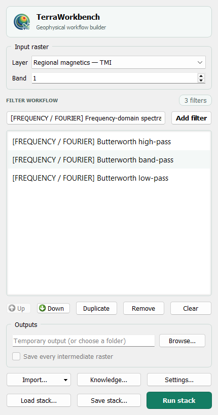

# TerraWorkbench

<a href="README.md">English</a> · <a href="README.es.md">Español</a> · <strong>Português</strong>

TerraWorkbench é um ambiente aberto no QGIS para gerenciar levantamentos geofísicos, processar seus dados e executar inversões. Seu motor Python, <code>terraworkbench_core</code>, também funciona sem QGIS; alguns fluxos ainda exigem adaptadores QGIS/GDAL ou dependências científicas opcionais.

## Recursos principais

### Bancos de levantamentos

Organize levantamentos em **Raster → TerraWorkbench → Survey databases…**: catálogo SQLite, canais Parquet imutáveis, versões de canais e linhagem exata das versões de entrada. Importe texto revisado ou Parquet plano, leia canais selecionados, calcule derivados, exporte CSV e crie camadas de pontos QGIS. Os originais permanecem intactos. É uma implementação para projetos locais: não há exclusão destrutiva de canais, editor de células ou interface para restaurar versões, nem certificação de desempenho em escala de campo. Consulte [workspaces de levantamentos](docs/guides/survey_workspaces.md).

### Processamento

| Área | Fluxos incluídos |
| --- | --- |
| Realce magnético | Derivadas horizontais/verticais, sinal analítico, THDR, tilt, TDX, theta e gradientes direcionais |
| Realce gravimétrico | Derivadas, continuação, separação regional/residual e amplitude do gradiente total |
| Redução gravimétrica | GRS80, distúrbio, ar livre, Bullard B, Bouguer, terreno com DEM e residual isostático Airy |
| Processamento espectral | Butterworth, filtros ideais, cosseno, cosseno direcional, continuação e integração |
| Correção de campo | RTP, RTE, transformação fonte-destino e IGRF-14 |
| Espectrometria gama | Produtos K/eU/eTh, ternários, dose, QC e correções calibradas de contagens brutas |
| Preparação de levantamentos | Importação, QC de voo/base/lag/rumo, linhas repetidas, nivelamento de cruzamentos, gridding e micronivelamento |
| Interpolação física | Fontes equivalentes Harmonica e previsão em altura relativa declarada |
| Automação | Processing, lotes, Modelador e receitas JSON reutilizáveis do Filter Stack |

O processamento básico inclui TPS global até 2.000 pontos únicos, aproximação TPS explicitamente local para entradas maiores, suavização binomial de nove pontos e controle automático de ganho por RMS local. Funcionam sem Oasis Montaj; não se afirma equivalência numérica proprietária. Consulte [escopo e limites](docs/guides/basic_processing_migration.md).

#### Entradas de levantamento compatíveis

| Entrada | Suporte e limites |
| --- | --- |
| Geosoft binário <code>.GRD</code> | Leitor nativo; recupera SRC e metadados disponíveis de título/data/XML |
| GeoTIFF, GXF, AAIGrid e XYZ regular | GDAL; conversão para GeoTIFF preparado para análise |
| Grid regular CSV/ASCII X-Y-valor | Exige grid regular completo; não interpola pontos irregulares silenciosamente |
| Camadas de pontos | IDW, vizinho mais próximo, TPS global/local e mínima curvatura experimental |
| Esri FileGDB | Rasters, classes de feições e tabelas via GDAL/OGR |
| Geosoft <code>.gdb</code> de arquivo único | Runtime BSD GX Developer opcional, somente Windows, para inventário/exportação em CSV aberto e camadas QGIS |

Um banco de canais Geosoft não é um Esri FileGDB. A ponte opcional não modifica levantamentos originais nem inclui código Geosoft no pacote.

<strong>Magnetic and gravity exploration filters</strong>

### Magnetic filters

- DX and DY first horizontal derivatives
- DZ first and DZ2 second vertical derivatives
- Configurable upward continuation and residual enhancement
- THDR total horizontal derivative and tilt angle
- Directional horizontal gradient with configurable azimuth
- AS / ASA analytic signal amplitude
- TDX horizontal tilt angle and theta angle map

### Gravity filters

- DX and DY first horizontal derivatives
- DZ first and DZ2 second vertical derivatives
- Configurable upward continuation
- Gaussian regional field and residual field
- THDR total horizontal derivative
- Tilt angle and total gradient amplitude

### Gravity corrections and anomalies

- GRS80 normal gravity and latitude-corrected gravity disturbance
- Linear free-air correction and free-air anomaly from observed gravity plus geometric elevation
- Infinite-plate Bouguer effect and simple Bouguer anomaly
- Bullard-B Earth-curvature correction for land elevations
- DEM rectangular-prism terrain correction with an explicit computation guard
- Complete land Bouguer anomaly: <code>observed - GRS80 + free-air - plate + terrain - Bullard B</code>
- Airy Moho-depth model and [regional isostatic residuals](docs/reference/methods/isostasy.md), with finite-prism and explicitly periodic FFT models

Observed gravity must be calibrated. Moving-platform points can use the explicit
survey-wide drift, external-tide and Eötvös correction tool before gridding; an
already reduced grid must not be corrected twice. Elevations must be geometric heights referenced to the ellipsoid and
aligned reduction rasters must share the same CRS, extent and pixel grid. Airy
uses a common vertical datum for model and stations, with an optional independent
regional grid in the same metric CRS. Station NoData is preserved; regional load
gaps are rejected. Direct forward modelling scales with station/prism pairs, so
the tools enforce a configurable safety limit and should use a defensible regional
resolution. The DEM/model extent is the outer correction boundary; inspect edges
and run density, depth and resolution sensitivity tests.

Canonical Processing IDs describe configurable operations:
<code>mag_directional_horizontal_gradient</code>, <code>mag_upward_continuation</code> and
<code>grav_upward_continuation</code>. Gradient azimuth and continuation distance are
configurable parameters and are not encoded as fixed values in their IDs.

<strong>Gamma-ray spectrometry and radiometric products</strong>

TerraWorkbench separates products made from calibrated concentration grids from
corrections applied to raw window count rates.

- configurable ratios between any aligned channels, including eTh/K, eU/K and eU/eTh;
- K-red, eTh-green, eU-blue ternary images with percentile stretch and optional normalization;
- terrestrial absorbed dose rate from K (%), eU (ppm) and eTh (ppm), with visible coefficients;
- interpretive <code>F = K × eU / eTh</code> product with denominator protection;
- JSON channel QC with missing, negative and robust distribution statistics;
- non-paralyzable detector dead-time correction;
- explicit aircraft, cosmic and atmospheric-radon background subtraction;
- exponential terrain-clearance normalization to a reference height;
- count-rate sensitivity calibration;
- three-window spectral stripping through a user-supplied response matrix.
- a pre-gridding point-channel chain that preserves raw fields and appends corrected cps, K, eU, eTh, dose and validity.

Raw corrections are not presets. Their coefficients must come from the detector
calibration and survey processing report. Already corrected public grids should
start at the product/QC tools rather than repeat acquisition corrections.
All multi-channel tools require identical CRS, extent, dimensions and pixel grid.
Line leveling, gridding and microleveling remain reusable for radiometric channels.

<strong>RTP, RTE and IGRF-14 magnetic transforms</strong>

- Reduction to the pole with automatic IGRF-14 or manual field direction
- Reduction to the equator
- General source-to-target magnetic field-direction transform
- Survey date recovered from imported metadata with manual override
- Optional remanent magnetization direction
- Explicit maximum-gain stabilization cap

Automatic mode evaluates IGRF-14 at the raster center, survey date and
observation altitude using <code>ppigrf</code>. Inclination is positive downward and
declination is clockwise from geographic North. RTP and RTE can be
ill-conditioned at low magnetic latitudes, so stabilization and result review
are required.

The Filter Stack groups RTP, RTE and the general field-direction transform under
**MAG field-direction transforms**. These operations use a two-dimensional FFT:
the raster is transformed from map space into spatial-frequency/wavenumber space,
the transfer function is applied there, and an inverse FFT returns a spatial
GeoTIFF. "FFT" describes the numerical domain, not a different kind of output.

<strong>FFT spectral processing and Filter Stack</strong>

TerraWorkbench exposes the numerical domain instead of treating every grid
operation as the same kind of filter. Algorithm labels use:

- **SPATIAL / FINITE DIFFERENCE** for cell-neighbour derivatives such as the
  default DX and DY exploration products
- **FREQUENCY / FOURIER** for transformations executed by a two-dimensional FFT
- **MIXED / SPATIAL + FREQUENCY** for products such as Tilt or analytic signal that combine
  spatial horizontal derivatives with an FFT vertical derivative
- **PHYSICAL MODEL / SPATIAL GRID** for Bouguer, terrain and gravity-reduction physics
- **SPATIAL / CELLWISE GRID** for independent transformations of aligned cells

The frequency-domain engine removes a mean or plane, reflect-pads the grid, applies a
cosine taper across only the padded margin, multiplies compatible transfer
operators on one forward 2D FFT, performs inverse transforms for requested
outputs, crops to the original footprint and optionally restores the trend.
Preprocessing parameters are stored with every stack recipe.

- Butterworth low-pass, high-pass, band-pass and notch
- FFT easting, northing and upward derivatives, orders 1–5
- Ideal band-pass and band-reject with an explicit ringing warning
- Cosine roll-off low-pass and high-pass
- Directional cosine pass and reject with configurable strike azimuth and degree
- Stabilized downward continuation with Butterworth taper and maximum-gain cap
- Horizontal integration in easting and northing, and vertical integration
- Magnetic pseudogravity from a phase-corrected RTP/RTE grid, with explicit interpretive scaling

The dockable Filter Stack feeds each output into the next filter. Steps can be
edited, reordered, duplicated and saved as JSON recipes. Results may remain
temporary or be written as a final GeoTIFF with every intermediate raster.

Wavelengths, continuation distances and pixel spacing use the raster CRS units.
FFT tools require an evenly spaced north-up raster in a projected CRS with no
NoData or non-finite cells.

<strong>Line QC, gridding and microleveling</strong>

**Crossover QC and tie-line leveling** operates on QGIS point layers. It builds
traverse and tie trajectories, interpolates measurements at crossings, rejects
robust MAD outliers and solves zero-mean constant, linear or damped quadratic
corrections for each connected line. Outputs preserve raw values and include corrected points,
crossover residuals, line corrections and RMS before/after.

**Magnetic preprocessing** can audit sample interval, spacing, speed, true-north
heading, turns, terrain clearance and channel rate without deleting data. It
removes IGRF-14 total intensity independently at every valid point after
base/lag/heading correction, and compares repeated lines by indexed spatial matches with
an optional robust median offset. Raw fields remain unchanged and every result
includes explicit correction, residual and validity fields.

Advanced acquisition QC estimates channel lag with a complete correlation curve,
audits magnetic base-station gaps/spikes/rate/drift (including midnight rollover),
detects anomalous inter-line spacing and likely missing lines, and samples a DEM
to verify drape/terrain clearance. Storm classification is deliberately excluded
unless an external geomagnetic index is supplied; DEM and platform heights must
share a vertical datum.

**Survey point gridding** supports a projected output CRS, density-based or
explicit cell size, IDW, nearest neighbor, global/local TPS and experimental
multilevel minimum curvature. Minimum curvature uses Briggs off-node constraints,
reports convergence and separates the initialization search radius from output
blanking. Its final domain does not inherit asymmetric coarse-grid rounding.
Windowed sinc interpolation requires a regular sample lattice and also supports
raster expansion; it does not directly grid irregular GPS points or increase
measured resolution. See [interpolation methods](docs/reference/methods/interpolation_methods.md)
for parameter semantics and limitations.

**Directional microleveling** estimates short across-line corrugation while
retaining longer along-line wavelengths. Both the corrected grid and removed
component are written for audit.

### Inversão 3D

SimPEG permite inversão limitada de contraste de densidade, suscetibilidade escalar e gravidade–magnetismo conjunta com gradiente cruzado. MVI admite coordenadas cartesianas e esféricas em etapas pela API pública <code>terraworkbench_core.inversion.run_potential_field_inversion</code>, com <code>kind="mvi"</code> e <code>mvi_parameterization="spherical"</code>; consulte o [contrato MVI esférico](docs/reference/methods/spherical_mvi.md). Uma implementação numérica não demonstra por si só recuperação geológica.

<strong>Entradas, saídas e limites de inversão</strong>

Os fluxos aceitam observações projetadas, incertezas, elevação dos receptores e topografia opcional. Admitem TensorMesh e TreeMesh refinada por observações/topografia, kernels integrais Choclo, sensibilidades em disco, limites de células ativas e cancelamento entre iterações. Densidade e suscetibilidade escalar expõem controles Lp/IRLS e modelo de referência limitado. MVI esférico possui controles de amplitude/ângulos e validação separados.

As coordenadas devem ser projetadas em metros; a declinação magnética geográfica é convertida para os eixos do grid pela convergência meridiana. As saídas incluem VTK, NPZ, QC JSON e CSV observado/predito/residual. A inversão não é única: avalie tamanho de célula, profundidade do domínio, incertezas, limites, topografia, campo indutor, regularização e pesos de acoplamento.

### Core independente

Instalável como <code>terraworkbench-core</code>, contém kernels numéricos e APIs de armazenamento/fluxos sem importar QGIS ou Qt. O plugin inclui a mesma implementação. Ainda não substitui de forma independente todos os fluxos Processing; a exportação GDAL nativa e parte da orquestração do host permanecem separadas. Consulte [escopo do Core](docs/development/scientific_core.md).

### Idiomas da documentação e interface

Os manuais e a interface estão disponíveis em inglês, espanhol e português. **Settings / Configuración** troca a interface e o catálogo Processing sem reiniciar QGIS, e armazena padrões de fluxo, carregamento de resultados, dicas científicas, caminho Geosoft opcional e acesso a dependências/exemplos. **Knowledge** abre a biblioteca local de capítulos.

## Instalação

A primeira instalação de dependências pode levar cerca de 10 minutos, conforme a conexão e os caches disponíveis.

### Plugin QGIS

A partir de uma cópia do repositório, gere o ZIP com o empacotador de lista explícita:

~~~sh
python scripts/package_plugin.py
~~~

Valida fontes/metadados e cria <code>dist/TerraWorkbench-1.0.1.zip</code>. No QGIS, abra **Plugins → Manage and Install Plugins → Install from ZIP** e selecione esse arquivo. A alternativa interativa Windows é <code>scripts/build_dist.bat</code>; solicita uma versão, portanto mantenha a atual se apenas empacotar.

O instalador Windows atual verifica a descoberta e depois instala/atualiza o perfil ativo:

~~~bat
scripts/install_update_open_qgis.bat --check
scripts/install_update_open_qgis.bat
~~~

Use <code>--no-launch</code> para não abrir QGIS. Defina <code>QGIS_ROOT</code> somente se a descoberta não selecionar a instalação desejada.

Os metadados declaram QGIS 3.28–3.x. O contrato de dependências 2D é [requirements/base.txt](requirements/base.txt); não fixa um mínimo global de Python para todas as combinações de pacotes. O Core independente declara Python ≥3.10. A inversão exige Python QGIS/independente ≥3.11 e a pilha opcional de [requirements/inversion.txt](requirements/inversion.txt): SimPEG 0.25, discretize 0.12 e Choclo 0.3.

O gerenciador integrado lê esses arquivos, instala somente com aprovação explícita em diretório próprio do perfil QGIS e preserva a precedência dos pacotes do host. Os pacotes 3D opcionais são separados do fluxo 2D. Reinicie QGIS após instalar ou reparar dependências; a compatibilidade das bibliotecas nativas depende do ambiente do host.

### Core com pip

Na raiz do repositório, use Python ≥3.10 com NumPy/SciPy declarados em <code>pyproject.toml</code>. O wheel independente não inclui exemplos ou componentes QGIS; execute o início rápido na cópia do repositório.

~~~sh
python -m pip install .
~~~

Para inversão, use primeiro Python ≥3.11 e instale <code>python -m pip install ".[inversion]"</code>. Outros extras, como <code>storage</code>, <code>prisms</code> e <code>coordinates</code>, estão em <code>pyproject.toml</code>. Instalar o Core não instala QGIS nem um ambiente GDAL nativo completo.

### Linux e macOS

O plugin foi testado no Windows. O plugin completo não foi testado no Linux ou macOS; a [validação de inversão](docs/validation/reports/inversion3d_extensions.md) registra CI no Linux em revisões identificadas.

## Início rápido

### QGIS

1. No TerraWorkbench, escolha **Import… → Bundled sample datasets** e carregue <code>synthetic_magnetic_anomaly.tif</code>.
2. Abra **Filter Stack**, adicione uma derivada magnética como DX, execute e examine o raster; salve a receita JSON se necessário.
3. Abra **Raster → TerraWorkbench → Survey databases…**, crie um workspace em uma pasta nova vazia e importe <code>sample_data/synthetic/synthetic_survey_points.csv</code> pelo assistente de revisão. Confirme canais, unidades e SRC explicitamente.

Os exemplos incluídos são pequenos dados sintéticos educativos em EPSG:32718, sob CC0-1.0; não são observações de campo nem evidência geológica. A [captura existente do Filter Stack](docs/assets/filter-stack.png) ilustra a interface. Originais locais de terceiros continuam excluídos dos pacotes salvo comprovação dos direitos de redistribuição.

### Python

Na raiz do repositório, leia uma linha sintética incluída e aplique uma média centrada de cinco amostras com o Core independente. Quatro amostras de borda ficam indefinidas porque o filtro exige janelas completas:

~~~python
from pathlib import Path
import numpy as np
from terraworkbench_core.channel_filters import ChannelFilterOptions, filter_segment

path = Path("sample_data/synthetic/synthetic_survey_points.csv")
data = np.genfromtxt(path, delimiter=",", names=True, dtype=None, encoding="utf-8")
line = data[data["line_id"] == data["line_id"][0]]
options = ChannelFilterOptions(method="mean", window=5)
filtered, diagnostics = filter_segment(np.arange(line.size), line["magnetic_nt"], options)
print("samples:", line.size, "finite filtered:", np.isfinite(filtered).sum())
~~~

## Reproduzir os benchmarks públicos

Use o [guia de processamento](docs/validation/reports/public_processing_benchmark.md) e o [guia de inversão](docs/validation/reports/public_inversion_benchmark.md), com seus catálogos de entradas fixadas e critérios numéricos declarados. Escolha o cache e uma nova pasta de saída explicitamente; por exemplo, <code>python scripts/benchmark_public_processing.py --cache PASTA_CACHE --output NOVA_SAIDA</code>. Preserve falhas e limitações. Repetir dados conhecidos não é validação cega nova nem garante identidade de ponto flutuante entre plataformas. Materiais editoriais do estudo permanecem no arquivo de desenvolvimento e não são necessários para usar o plugin público.

## Documentação

- [Manual inglês](docs/manuals/en/README.md), [manual espanhol](docs/manuals/es/README.md), [manual português](docs/manuals/pt/README.md) e [visão geral](docs/manuals/README.md).
- [Handbook e base de conhecimento](docs/handbook/README.md).
- [Índice da documentação](docs/README.md) e [estrutura do repositório](docs/development/repository_structure.md).

## Validação e limites

Comece pela [evidência de validação](docs/validation/README.md) e pelo [relatório de referência/recuperação MVI](docs/validation/reports/mvi_reference_validation.md). A [validação MVI esférica](docs/reference/methods/spherical_mvi.md) é separada e não elimina falhas dos benchmarks cartesianos. A inversão não é única; resultados de recuperação, incluindo critérios que falharam, estão documentados. Um bom ajuste não estabelece profundidade, volume ou direção de magnetização únicos.

Requisitos e limites científicos permanecem nas seções expansíveis: FFT exige raster regular projetado, orientado ao norte, sem NoData/não finitos; estabilização RTP/RTE, calibração instrumental, datums verticais coerentes e sensibilidade às bordas de correção exigem revisão. A concordância com referências independentes limita-se aos casos registrados, sem equivalência universal.

## Como citar

Use [CITATION.cff](CITATION.cff) para citar o software e registre a revisão exata utilizada. DOI arquivístico do software para todas as versões: [10.5281/zenodo.24119093](https://doi.org/10.5281/zenodo.24119093); cada versão também tem seu DOI próprio no Zenodo (1.0.0: [10.5281/zenodo.24119094](https://doi.org/10.5281/zenodo.24119094)). O arquivo deixa como comentários os identificadores ainda não atribuídos, como o ORCID.

## Contribuir

Consulte [CONTRIBUTING.md](CONTRIBUTING.md) para relatar problemas, executar testes e Ruff, e respeitar a separação Core/plugin. Responsável: Jordan Zavaleta (GisGeo Dev), [jordanzav@gisgeo.dev](mailto:jordanzav@gisgeo.dev).

## Licença e software de terceiros

TerraWorkbench usa [GPL-3.0-or-later](LICENSE). Bibliotecas de terceiros mantêm suas licenças; consulte [avisos de terceiros](docs/legal/THIRD_PARTY_LICENSES.md). É um projeto comunitário independente, não um produto oficial de QGIS, Fatiando a Terra ou SimPEG. Copyright © Jordan Zavaleta.

## Estado do projeto

O plugin **1.0.1** é a versão publicada atual; o pacote Core independente é **0.1.0**. As correções são publicadas como versões 1.0.x. Os métodos documentados como experimentais mantêm essa condição.

A [campanha pública de processamento](docs/validation/reports/public_processing_benchmark.md) registra entradas fixadas e referências numéricas independentes; os [relatórios de inversão](docs/validation/README.md) distinguem execução, convergência e recuperação. Verificações históricas QGIS 3.44, Processing/Filter Stack e estrutura ZIP são evidência de suas revisões registradas.

Antes da publicação oficial no QGIS, permanecem validação e envio ao repositório, notificação de publicação NRCan pendente e comparações científicas independentes mais amplas. Interfaces, parâmetros e formatos salvos podem mudar antes de uma release pública.

## Desinstalação completa

Primeiro abra o gestor de dependências do TerraWorkbench e pressione **Remover dependências e preferências**. Confira a pasta exata do perfil ativo, o número de arquivos, o total de bytes e as chaves; depois confirme. Reinicie o QGIS conforme indicado; se o plugin continuar instalado, solicitará reinstalar as dependências. Para desinstalar completamente, remova o TerraWorkbench pelo **Gerenciar e Instalar Complementos** do QGIS após a limpeza.

Alternativa manual: feche o QGIS e remova somente <code>PERFIL_ATIVO/python/dependencies/TerraWorkbench/PYTHON_MAJOR.MINOR</code>, usando o perfil informado pelo QGIS, inclusive com raiz de perfis personalizada. Remova somente as chaves sob <code>TerraWorkbench/</code> da configuração QSettings desse perfil: defaultOutputDirectory, keepIntermediate, defaultBand, openInspectorAfterAdd, confirmClearStack, addFinalResultToProject, showScientificTooltips, geosoftLocation, localTestDataDirectory, language, dependencyDialogVersion e surveyWorkspace. Confira outras chaves do mesmo espaço. Preserve outros perfis, versões do Python e plugins. A ação automática recusa links e junções; nunca apaga ao executar unload ou desativar o plugin. DLLs carregadas podem impedir a remoção no Windows; pare de usar o plugin, reinicie o QGIS e use a alternativa manual se necessário.
