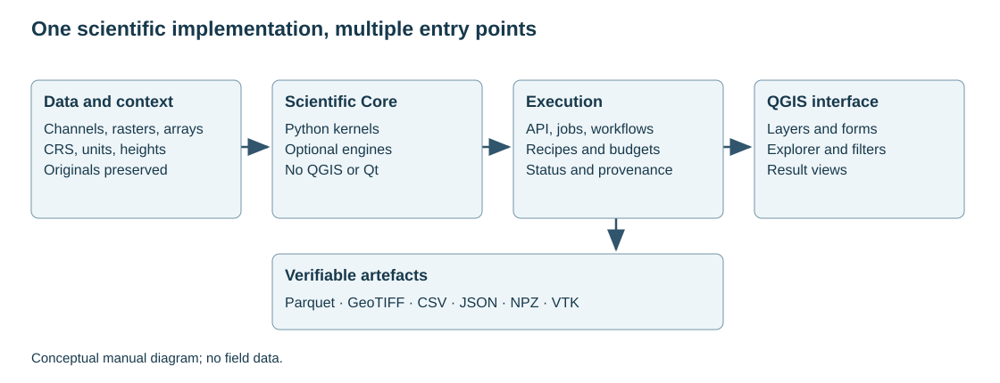

# 1. What TerraWorkbench is and where to start

[English](../en/01_inicio.md) · [Español](../es/01_inicio.md) · [Português](../pt/01_inicio.md)

## Purpose and scope

TerraWorkbench brings together survey storage, processing and geophysical modelling. The Core is a Python package independent of QGIS; the plugin supplies layer readers, forms and Processing tools. The same scientific operation can be called from Python or a plugin adapter. Having an API does not mean that a specialised form exists for it.

This manual is for users importing their first file and for those automating a campaign. It describes the available code and the checks each procedure needs. Its capability inventory is not a certificate of equivalence with other products.

Figure 1. Separation of data, scientific engine, execution and presentation. This is an architecture diagram, not a field run.

## Three questions before processing

1. What does the observation represent? Total field, anomaly, gradient, observed gravity, concentration and detector counts are different quantities.
2. Where and when was it measured? Record coordinates, elevation, date, trajectory and sensor position.
3. What is the intended result? A visual enhancement, a physical quantity, a prediction and a subsurface model require different checks.

A reasonable sequence begins with import and QC, continues with justified corrections, produces channels or grids, and ends with analysis, validation and export. Different disciplines do not follow identical steps: applying IGRF to radiometry or a Bouguer correction to a magnetic anomaly has no physical meaning.

## Reading paths

For database work, read chapters 2–7 first. For GRD and filters, continue with 8–10. The disciplines are developed in 11–23. The interface, automation and examples are in 24–27. Chapter 28 explains how to verify and communicate results.

Chapters link to their implementations and detailed guides. The API reference derives signatures from the code, including utilities outside the process catalogue. Signatures explain how to call a function; chapters explain when its use is defensible.

## Working vocabulary

| Term | Meaning |
| --- | --- |
| Channel | A variable aligned with database rows |
| Version | Channel content identified immutably |
| Grid | Values on a regular, georeferenced lattice |
| Recipe | Explicit parameters and sequence of operations |
| Lineage | Dependencies between input and output versions |
| QC | Observation integrity and quality checks |
| Validation | Evidence that an operation meets defined criteria for a use |

See also [repository structure](../../development/repository_structure.md) and the [evidence policy](../../handbook/README.md).

## Related implementation

[__init__](../../../terraworkbench_core/__init__.py)

---

[Contents](README.md) · [Next](02_instalacion.md)
