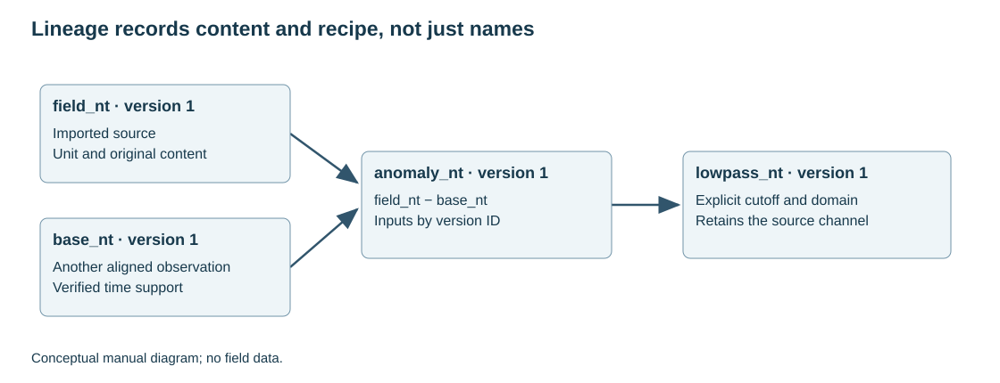

# 5. Workspaces, channels, versions and lineage

[English](../en/05_bases_canales.md) · [Español](../es/05_bases_canales.md) · [Português](../pt/05_bases_canales.md)

## Storage model

SurveyStore combines a SQLite catalogue and immutable Parquet files. The catalogue identifies databases, channels, versions and events. Parquet supports column and batch reads, so processing one variable need not load every channel. A workspace is a working unit, not a proprietary GDB file.

A database preserves row alignment. Column selection leaves that alignment intact. A mask or view filter restricts a query; it does not automatically reorder acquisition. Stored geometry identifies XY channels and CRS without transforming coordinates.

## Your first database in the interface

Open **Databases…** in the Filter Stack or **Survey databases…** in QGIS's Raster menu. If the active layer belongs to a survey, the explorer selects that database. After importing text or a GDB, click **Open database** in the QGIS message bar to open the imported database at its first line. Create a new workspace in an empty folder and review the text import wizard before accepting.

Selecting a database opens a read-only sheet with every channel. Line, fiducial or time, X and Y come first. Remaining channels follow the database order. Headers show units and a tooltip with the source, type and version. The line search and arrows follow acquisition row order. An assigned line role takes precedence over name detection. Use the line channel button to override it. The line is read in small batches as you scroll. **All rows** uses paginated results and the existing view filters.

Use **Columns…** or the header context menu to change visible columns. The workspace remembers the visibility for each database. A table column or the sidebar selection can drive channel actions. **Profiles** follows the selected line and marked numeric channels. Clicking a row places a marker at its sample position. Keep the complete workspace folder when backing up products.

Figure 2. Conceptual sources and derived channels. The input version, in addition to its name, determines the content processed.

## Add a survey to the QGIS map

In the text import assistant, review the X, Y and optional line roles and select the source CRS if it is missing. When coordinates and CRS are known, TerraWorkbench adds a survey group automatically. Select a database and choose **Add survey to map…** to rebuild it from a filtered selection or to assign missing coordinates and CRS in a single dialog.

The group contains Flight lines, Tie lines when present, Survey boundary and Samples. Endpoint labels appear as the map is zoomed in. Samples starts switched off and has its own scale limit. A database without a line channel receives only Samples and Survey boundary. The GeoPackage is saved under the workspace results directory. [Map geometry and classification rules](../../development/survey_map_layers.md).

Flight lines are dark gray and tie lines are dark orange. Both have a white halo and show arrows in acquisition direction at 1:150,000 or closer. Other lines are dotted. The boundary uses white and teal strokes with a subtle inward fade.

## Creating a derived variable

Name the quantity and unit first: mag_anomaly_nt, gravity_complete_bouguer_mgal or sensor_height_m. Add the distinguishing step when alternatives are needed, such as mag_anomaly_lowpass_nt. A label does not replace recorded parameters.

Formula expressions use a restricted arithmetic language. For example, c("field_nt") − c("main_field_nt") subtracts aligned channels. This is not a general Python interpreter and must not be used for imports or external instructions.

Derivation retains input versions. If content changed after recipe review, stop and review again. Duplicating a channel can alias the same immutable version without copying its full bytes; later versions evolve independently.

## Publishing external calculations

publish_channels receives arrays matching database row count, a unit per output, exact versions of the channels used and provenance naming the operation. Output names must be new. Outputs publish together transactionally; NaN becomes null, while infinity or incompatible lengths are rejected.

Recording parameters, libraries and engine makes them visible in the lineage inspector. Include topography, inducing-field and selection channels if they contributed, even when they do not appear directly in the final formula.

## Capacity and safe work

Total database capacity differs from a filter's per-run limit. Channel filtering supports up to three million samples per continuous run, subject to other budgets. A multi-line database can contain more rows. Do not concatenate lines to bypass continuity controls.

The published-array budget bounds their combined float64 size; it is not a process RAM limit and excludes engine buffers. Keep originals separate from derived files and back up catalogue and Parquet coherently.

See [workspaces](../../guides/survey_workspaces.md), [explorer](../../guides/survey_explorer.md) and [evidence contracts](../../guides/api_evidence.md).

## Related implementation

[survey_store](../../../terraworkbench_core/survey_store.py), [survey_explorer](../../../terraworkbench_core/survey_explorer.py), [survey_recipes](../../../terraworkbench_core/survey_recipes.py)

---

[Contents](README.md) · [Previous](04_importacion.md) · [Next](06_perfiles_qc.md)
