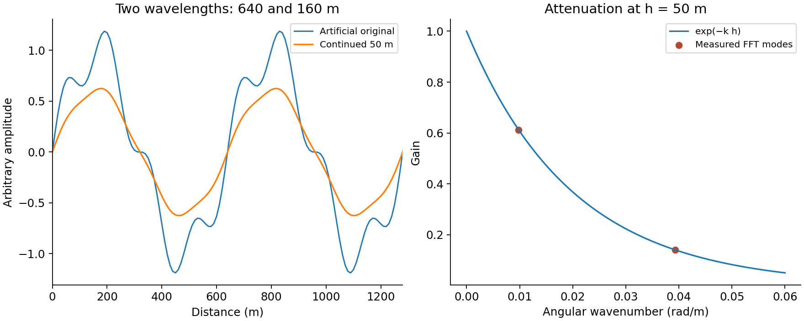

# 9. FFT, continuation, derivatives and spectral analysis

[English](../en/09_fft_espectros.md) · [Español](../es/09_fft_espectros.md) · [Português](../pt/09_fft_espectros.md)

## Sampling and preparation

2D FFT needs a regular raster and consistent horizontal units. frequency_grid returns angular wavenumbers kx, ky and their magnitude, in radians per length unit. Do not supply cycles/m where rad/m is expected. Nyquist frequency is 1/(2Δx) in cycles per length; cell spacing limits representation of short wavelengths.

prepare_fft_grid can remove a mean or plane, reflect-pad edges, taper outside the original footprint and handle gaps under an explicit policy. Its state passes to finish_fft_grid for cropping, mask recovery and optional trend restoration. Nearest filling enables spectral calculation but does not turn gaps into measurements.

## Elementary operators

    Upward continuation: H(k,h) = exp(−k h), h > 0
    X derivative: Hx = i kx
    Y derivative: Hy = i ky

The vertical derivative requires the API's vertical convention. Do not transfer a downward-positive z sign to an upward-positive mesh merely because function names look alike. Derivatives amplify high frequencies and must be assessed together with noise.

Figure 3. An artificial periodic signal with two wavelengths. Markers show the transfer measured after processing with Core functions; the curves are not a survey or an independent engine comparison.

## Transfer selection

Butterworth gives gradual transitions; ideal filters have abrupt transitions and may produce ringing. Directional filters need azimuth and angular width. A notch can remove both interference and signal. A tabulated radial transfer needs wavenumbers increasing from zero and an explicit gain budget; the final gain is retained above the last tabulated knot.

Downward continuation increasingly amplifies short wavelengths and is unstable without regularisation. Stabilisation and maximum gain are part of the method. Integration is singular at zero frequency or on axes; record which modes are removed or stabilised. Do not restore a trend after a derivative or high-pass merely because a helper allows it.

## Spectra and interpretation

### Live preview and colours

The input window is cached across parameter edits. Changing the extent, band, source or file timestamp invalidates that single-window cache.

Enable Live preview in the Filter Stack. Edits and map navigation debounce for 300 ms; one background worker cancels obsolete requests and publishes only the newest result. A single temporary Preview layer represents the stack through the selected filter. F6 toggles before/after. Disabling preview or closing the dock removes it. Apply executes the entire stack at native resolution with provenance.

The preview reads the visible extent with a 50% observation margin on each side, clipped to the source, at screen resolution (visible side capped at 512 samples). FFT filters retain their reflection/taper settings; other stacks receive an additional reflected and tapered margin. Regional wavelengths, sharp cutoffs and unstable RTP can require observations beyond the window. Compare the native result before interpretation.

Adjust colours (GeoRamp) opens interactive scientific palettes and histograms for the preview or input. Magnetic products use classic_geophysics; signed derivatives and tilt use blue_white_red with symmetric limits around zero. Install GeoRamp opens its plugin-manager entry when unavailable. QGIS resolves the declared GeoRamp dependency; ZIP installs may require a separate installation.

radial_power_spectrum and spectral_analysis offer PSDs, binning and depth fits. Check detrending, normalisation, rings/sectors, k range and samples per bin. Spectral slope depends on the source model and fitted interval: regression error is not geological depth uncertainty.

matched_layer_filters, Wiener and coherence/admittance use prescribed models, noise or layers; they do not independently discover correct geometry. Historical preparation helpers retain recipe compatibility; their names do not prove equivalence with other software.

See [spectral analysis and scope](../../research/core_expansion_implementation.md), [radial filters](../../reference/methods/magnetic_component_api.md) and the [practical handbook](../../handbook/handbook_en.md).

## Related implementation

[spectral](../../../terraworkbench_core/spectral.py), [spectral_analysis](../../../terraworkbench_core/spectral_analysis.py), [radial_filters](../../../terraworkbench_core/radial_filters.py), [filter_recipes](../../../terraworkbench_core/filter_recipes.py), [classic_style](../../../terraworkbench_core/classic_style.py)

---

[Contents](README.md) · [Previous](08_filtros_espaciales.md) · [Next](10_magnetometria.md)
