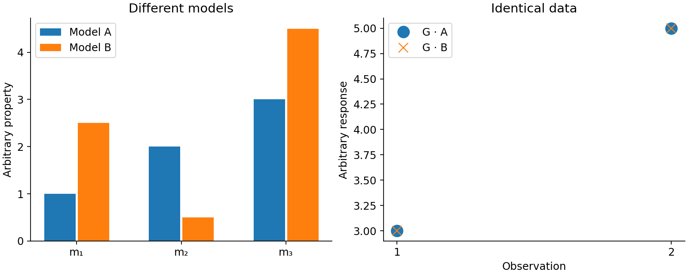

# 17. Convergence, resolution, uncertainty and validation

[English](../en/17_resolucion_incertidumbre.md) · [Español](../es/17_resolucion_incertidumbre.md) · [Português](../pt/17_resolucion_incertidumbre.md)

## Separate four outcomes

| Outcome | Demonstrates | Does not demonstrate |
| --- | --- | --- |
| Complete files | Workflow completion and publication | Physical correctness |
| Accurate inner solver | Numerical system solved to audited tolerance | Outer objective reached |
| Good observation fit | Compatibility with chosen data and sigma | A unique or true model |
| Independent recovery | Defined criterion met against a reference | Universal validity outside that domain |

High voxel error with small data misfit may reflect non-uniqueness, weak sensitivity, regularisation or experimental errors. Neither assume a software bug nor dismiss an implementation without checking operators, units, active indices and geometry.

Figure 4. An artificial linear problem with more parameters than observations. Different models produce identical data to numerical precision. This illustrates null space, not a field geophysical experiment.

## Reading diagnostics

weighted_rms and target_reached describe the data criterion. iterations and iteration_limit_reached describe outer budget. CG metrics describe inner-solve accuracy and, where relevant, raw/scaled tolerances. Nonconverged output remains nonconverged even when a VTK or plausible image exists.

Also inspect bound-active cells, relative model change, beta, norms and spatial residuals. A bound-touching model may need sensitivity analysis; increasing bounds until holdout error improves makes that holdout part of recipe selection.

## Resolution tools

inversion_diagnostics offers fixed linear-L2 controls, error partition, resolution and reference-model DOI. matrix_free_resolution provides budgeted stochastic estimates and point-spread functions. These analyses condition on fixed operator, weights and regularisation; they are not complete nonlinear uncertainty with free geology.

linear_gaussian_ensemble describes a linear Gaussian problem with a defined prior. It is not the posterior of a bounded, IRLS, adaptive-mesh inversion or a stochastic reinterpretation of beta selection. Present conditional covariance with that scope.

## Campaign design

1. Check forward physics against analytic sources and an independent engine.
2. Compare active indexing, signs, units and export.
3. Freeze recipes and criteria before inspecting reserved results.
4. Reserve lines, blocks or an entire survey as appropriate.
5. Vary resolution, starting point and assumptions on training data.
6. Evaluate final holdout and retain failures.

spatial_holdout and training_plane separate selection and fitting, but an interleaved holdout within one survey can be optimistic. model_recovery_metrics requires truth and compatible masks; do not create geological truth from the recovered model itself.

See [convergence/resolution](../../validation/reports/inversion_convergence_resolution.md), [public benchmark](../../validation/reports/public_inversion_benchmark.md), [voxel recovery](../../validation/reports/voxel_recovery_validation.md) and [MVI evidence](../../validation/reports/mvi_reference_validation.md).

## Related implementation

[inversion_diagnostics](../../../terraworkbench_core/inversion_diagnostics.py), [inversion_evidence](../../../terraworkbench_core/inversion_evidence.py), [matrix_free_resolution](../../../terraworkbench_core/matrix_free_resolution.py), [recovery_metrics](../../../terraworkbench_core/recovery_metrics.py), [advanced_statistics](../../../terraworkbench_core/advanced_statistics.py), [_calibration](../../../terraworkbench_core/_calibration.py)

---

[Contents](README.md) · [Previous](16_mvi_conjunta.md) · [Next](18_electrica_dc.md)
