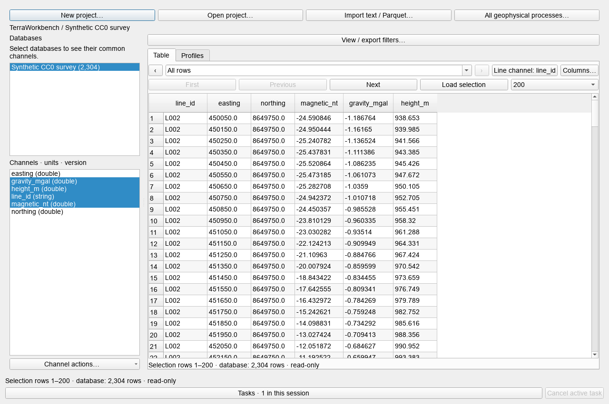
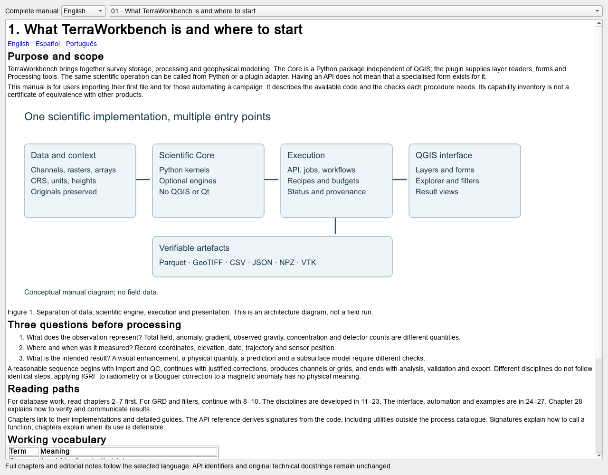

# 24. QGIS interface, forms, languages and captures

[English](../en/24_gui_qgis.md) · [Español](../es/24_gui_qgis.md) · [Português](../pt/24_gui_qgis.md)

## Interface entry points

In QGIS, open Raster → TerraWorkbench → Geophysical processes. The same menu exposes the database explorer, filter stack, dependencies and knowledge base. Visible wording depends on language and host version.

The process centre combines the QGIS provider and advanced Core catalogue. The survey explorer opens workspaces, selects databases/channels, previews pages, applies view filters and displays profiles. The filter dock works on rasters. These spaces do not represent the same data types or share every parameter.

Availability is process-specific. Some APIs have dedicated forms; others use advanced argument editors. A module function outside the registry still needs Python or explicit orchestration.

## Working with a grid

1. Import GRD or another raster and review its working conversion.
2. Confirm layer, units, CRS and mask.
3. Select an operation and review parameters.
4. Execute to a new output; inspect differences and boundaries.
5. Save recipe and products needed to repeat the sequence.

An empty output folder may use processing temporaries. A chosen folder establishes a run context and retains recipe/intermediates according to the tool. A recipe does not certify identical input bytes on the next execution.

## Quick hillshade

Select a single-band raster and click **Hillshade** beside **Work folder** in the Filter Stack. The same options appear in the raster's context menu. The click applies the GeoRamp classic geophysics ramp between the 2nd and 98th percentiles of valid samples and inserts an on-the-fly QGIS hillshade above the raster. It creates no files. Click again to hide or show the effect. The menu lets you change azimuth, altitude, intensity (×0.5, ×1, ×2 or ×4) and palette (classic or grayscale). The default is 315° azimuth and 45° altitude, with Multiply blending at 34% opacity.

**Calculate hillshade…** writes a Float32 GeoTIFF with the source geometry and NoData. Azimuth is clockwise from north. Use the compass shortcuts, select several azimuths for individual outputs, or choose **Combined (multidirectional)** for the arithmetic mean with equal weight 1/N for each of the N selected directions. The calculation runs in the background. Results join the source's group and go to the project's work folder or QGIS temporary storage. Each GeoTIFF records its source, angles, weights and effective z factor.

The automatic z factor is tan(30°) divided by the 90th percentile of the finite gradient magnitudes, computed per horizontal coordinate unit using the pixel spacing. If that percentile is zero, it uses the 90th percentile of positive gradients. A flat grid uses a factor of one. The visual effect estimates gradients from tiles of adjacent native cells. Multiplying all grid values by a positive constant divides the automatic factor by the same constant. The calculation also accepts an explicit factor.

## Advanced forms

Forms use actual signatures, authored labels in three languages and validators. Required physical values are not invented. Arrays can come from NPZ through @name or a $array JSON object. Review shape, dtype, units and length; header inspection does not load or validate all array physics.

NPZ does not allow pickled objects. JSON/array budgets apply; jobs retain manifest.json and arrays.npz. Original engine errors may be English. API IDs, recipe keys and channel names remain stable across language changes.

## Capturing without controlling the desktop

ui.evidence_api needs a real QApplication on the offscreen platform. Isolate profile and QSettings before creating widgets to avoid changing user preferences. capture_widget saves an actual widget to a new PNG; capture_workspace opens an existing database and waits for preview. Desktop platforms and overwrites are rejected.

Figure 5. Actual offscreen capture of the bundled CC0 synthetic survey. It documents database/interface integration with artificial values, without a field-survey inversion or geological validation. The historical image filename is retained for link compatibility.

Offscreen rendering does not replace accessibility, interaction or display tests on each supported desktop. Running the engine does not require a visible application window.

See [workbench guide](../../guides/geophysical_workbench_gui.md), [localisation](../../guides/localization.md), [capture API](../../guides/api_evidence.md) and [QGIS catalogue](../../reference/catalogues/qgis.md).

Figure 6. Actual 28-chapter reader captured through the offscreen API. The reader language does not change global user preferences.

---

[Contents](README.md) · [Previous](23_integracion_experimentos.md) · [Next](25_api_workflows.md)
