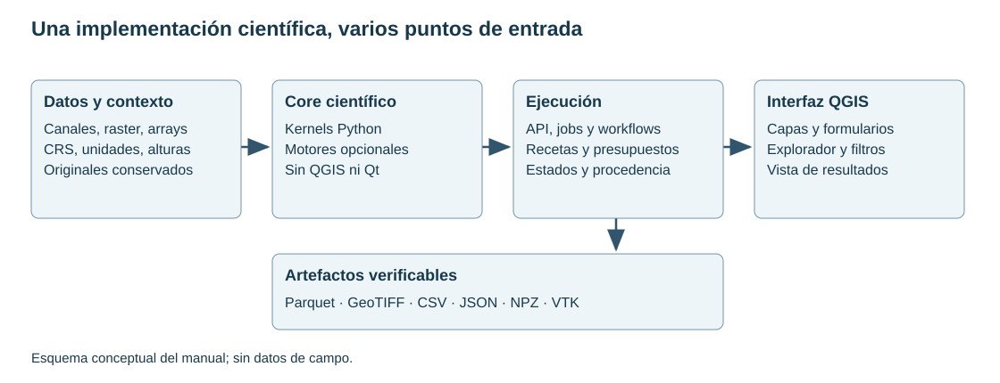

# 1. Qué es TerraWorkbench y cómo empezar

[English](../en/01_inicio.md) · [Español](../es/01_inicio.md) · [Português](../pt/01_inicio.md)

## Propósito y alcance

TerraWorkbench reúne almacenamiento de levantamientos, procesamiento y modelado geofísico. El Core es un paquete Python independiente de QGIS; el plugin aporta lectura de capas, formularios y herramientas de Processing. La misma operación científica puede llamarse desde Python o desde un adaptador del plugin. Una API disponible no implica que exista un formulario especializado para ella.

Este manual está dirigido tanto al usuario que importa su primer archivo como a quien necesita automatizar una campaña. Describe el código disponible y los controles que necesita cada procedimiento. No presenta el inventario de capacidades como una certificación de equivalencia con otros productos.

Figura 1. Separación entre datos, motor científico, ejecución y presentación. Es un esquema de arquitectura; no representa una corrida de campo.

## Tres preguntas antes de procesar

1. ¿Qué representa la observación? Campo total, anomalía, gradiente, gravedad observada, concentración y cuentas de detector son cantidades distintas.
2. ¿Dónde y cuándo se midió? Registrar coordenadas, elevación, fecha, trayectoria y posición del sensor.
3. ¿Qué se pretende obtener? Una mejora visual, una magnitud física, una predicción y un modelo del subsuelo requieren controles diferentes.

Una secuencia razonable empieza con importación y QC, continúa con correcciones justificadas, produce canales o grillas y termina con análisis, validación y exportación. No todas las disciplinas recorren los mismos pasos: aplicar IGRF a radiometría o una corrección Bouguer a una anomalía magnética no tiene sentido.

## Ruta de lectura

Para trabajar con una base, leer primero los capítulos 2 a 7. Para GRD y filtros, continuar con 8 a 10. Las disciplinas se desarrollan en 11 a 23. La interfaz, automatización y ejemplos están en 24 a 27. El capítulo 28 explica cómo verificar y comunicar resultados.

Los capítulos enlazan sus implementaciones y guías detalladas. La referencia de API ofrece firmas derivadas del código, incluyendo utilidades que no forman parte del catálogo de procesos. Las firmas explican cómo llamar una función; los capítulos explican cuándo es defendible utilizarla.

## Vocabulario operativo

| Término | Significado |
| --- | --- |
| Canal | Una variable alineada con las filas de una base |
| Versión | Un contenido de canal identificado de manera inmutable |
| Grilla | Valores sobre una malla regular con georreferenciación |
| Receta | Parámetros y secuencia explícita de operaciones |
| Linaje | Dependencias entre versiones de entrada y salida |
| QC | Comprobaciones de integridad y calidad de observaciones |
| Validación | Evidencia de que una operación satisface criterios definidos para un uso |

Consultar también la [estructura del repositorio](../../development/repository_structure.md) y la [regla de evidencia](../../handbook/README.md).

## Implementación relacionada

[__init__](../../../terraworkbench_core/__init__.py)

---

[Índice](README.md) · [Siguiente](02_instalacion.md)
