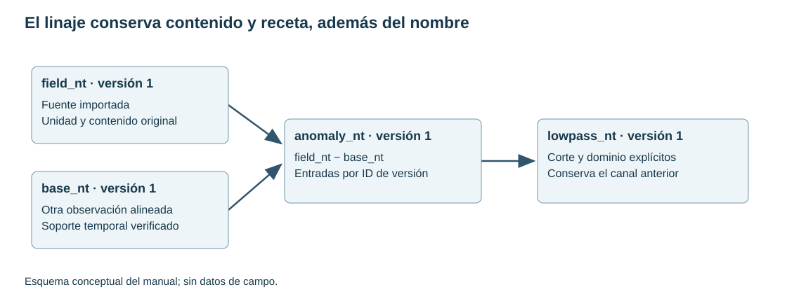

# 5. Workspaces, canales, versiones y linaje

[English](../en/05_bases_canales.md) · [Español](../es/05_bases_canales.md) · [Português](../pt/05_bases_canales.md)

## Modelo de almacenamiento

SurveyStore combina un catálogo SQLite con archivos Parquet inmutables. El catálogo identifica bases, canales, versiones y eventos. Parquet permite lectura por columnas y lotes; no es necesario cargar todas las variables para procesar una sola. El workspace es una unidad de trabajo, no un archivo GDB propietario.

Una base conserva alineación de filas. Seleccionar columnas no altera esa alineación. Una máscara o un filtro de vista limita una consulta; no reordena automáticamente la adquisición original. La geometría almacenada identifica canales XY y CRS, sin transformar sus coordenadas.

## Primera base desde la interfaz

Abrir **Bases de datos…** en la Pila de filtros o **Bases de levantamientos…** en el menú Ráster de QGIS. Si la capa activa pertenece a un levantamiento, el explorador selecciona su base. Tras importar texto o una GDB, pulsar **Abrir base de datos** en la barra de mensajes de QGIS para abrir la base importada en su primera línea. Crear un workspace nuevo en una carpeta vacía y revisar el asistente de texto antes de aceptar.

Al seleccionar una base se abre una hoja de solo lectura con todos los canales. Primero aparecen línea, fiducial o tiempo, X e Y. El resto conserva el orden de la base. Los encabezados muestran la unidad y un tooltip con origen, tipo y versión. El buscador y las flechas recorren las líneas en orden de aparición. El rol de línea asignado tiene prioridad sobre la detección por nombre. El botón de canal de línea permite cambiarlo. Al desplazarse, la hoja lee pequeños lotes. **Todas las filas** usa páginas y los filtros de vista existentes.

Usar **Columnas…** o el menú contextual del encabezado para cambiar la visibilidad. La configuración se recuerda por base. Las acciones de canales usan una columna de la hoja o la selección lateral. **Perfiles** sigue la línea y los canales numéricos marcados. Al pulsar una fila se señala su posición de muestra. Conservar la carpeta completa del workspace al respaldar los productos.

Figura 2. Un ejemplo conceptual de fuentes y canales derivados. La versión de entrada, además del nombre, determina qué contenido se procesó.

## Añadir un levantamiento al mapa de QGIS

En el asistente de texto se revisan los roles X, Y y línea opcional, y se elige el CRS de origen si falta. Con coordenadas y CRS conocidos, TerraWorkbench añade automáticamente un grupo. La acción **Añadir levantamiento al mapa…** permite regenerar el grupo con una selección filtrada o asignar las coordenadas y el CRS pendientes en un único diálogo.

El grupo incluye Líneas de vuelo, Líneas de control si existen, Contorno del levantamiento y Muestras. Las etiquetas de extremo aparecen al acercarse. Muestras se carga apagada y tiene un límite de escala propio. Sin canal de línea solo se generan Muestras y Contorno del levantamiento. El GeoPackage se guarda en results del workspace. [Reglas de geometría y clasificación](../../development/survey_map_layers.md).

Las líneas de vuelo son gris oscuro y las de control naranja oscuro. Ambas llevan halo blanco y muestran flechas en el sentido de adquisición a 1:150.000 o más cerca. Otras líneas son punteadas. El contorno tiene doble trazo, blanco y turquesa, con un brillo interior que se desvanece hacia dentro.

## Crear una variable derivada

Se recomienda expresar primero la magnitud y su unidad: mag_anomaly_nt, gravity_complete_bouguer_mgal o sensor_height_m. Añadir el paso distintivo cuando se necesiten alternativas, por ejemplo mag_anomaly_lowpass_nt. Una etiqueta no sustituye los parámetros registrados.

La fórmula usa un lenguaje aritmético restringido. Por ejemplo, c("field_nt") − c("main_field_nt") calcula una resta de canales alineados. No es un intérprete Python general y no debe usarse para ejecutar imports o instrucciones externas.

La derivación conserva versiones de entrada. Si el contenido cambió desde la revisión de la receta, detenerse y revisar otra vez. Duplicar un canal puede crear un alias de la misma versión inmutable sin copiar todos sus bytes; versiones posteriores evolucionan por separado.

## Publicar cálculos externos

publish_channels recibe arrays de longitud igual a las filas de la base, unidad por salida, versiones exactas de los canales usados y procedencia con nombre de operación. Solo admite nombres nuevos. Las salidas se publican juntas bajo transacción; NaN se guarda como nulo e infinitos o longitudes distintas se rechazan.

Registrar parameters, libraries y engine permite mostrar parámetros, bibliotecas y motor en el inspector de linaje. Incluir también fuentes de topografía, campo inductor y selección si participaron en el cálculo, aunque no aparezcan directamente en la fórmula final.

## Capacidad y trabajo seguro

La capacidad total de una base no es el límite de un filtro por tramo. El filtrado de canales admite hasta tres millones de muestras por tramo continuo, sujeto a los demás presupuestos. Una base con varias líneas puede contener más filas. No concatenar líneas para eludir controles de continuidad.

Un presupuesto de arrays publicados limita su tamaño float64 combinado; no limita toda la RAM del proceso ni incluye buffers del motor. Guardar originales fuera de los archivos derivados y respaldar catálogo y Parquet de manera coherente.

Ver [workspaces](../../guides/survey_workspaces.md), [explorador](../../guides/survey_explorer.md) y [contratos de evidencia](../../guides/api_evidence.md).

## Implementación relacionada

[survey_store](../../../terraworkbench_core/survey_store.py), [survey_explorer](../../../terraworkbench_core/survey_explorer.py), [survey_recipes](../../../terraworkbench_core/survey_recipes.py)

## Perfiles por línea

En la hoja de bases, elige una línea y pulsa **Perfiles**. En QGIS también puedes activar **Elegir perfil en el mapa** y hacer clic sobre una línea del levantamiento, o seleccionar una entidad de línea o muestra. El panel marca la muestra más cercana a esa posición. Al pasar el cursor sobre el perfil, QGIS marca la muestra en el mapa.

Marca los canales que quieres ver. Cada gráfico tiene su propia escala vertical. Elige el eje de fiducial o distancia acumulada en metros, según los canales y el CRS de la base. Usa la rueda para acercar, arrastra con el botón derecho para desplazar y pulsa las flechas izquierda y derecha sobre el gráfico para recorrer las líneas.

Haz clic para seleccionar una muestra o arrastra con el botón izquierdo para seleccionar un tramo. El gráfico activo es el canal que se edita. **Dummy** marca las muestras como nulas y **Deshacer** y **Rehacer** recorren el historial. **Interpolar** rellena huecos interiores por el eje actual con un método lineal o Akima. Si no hay tramo seleccionado, se usa toda la línea. Akima requiere cinco posiciones válidas distintas. Las estadísticas se calculan con todas las muestras del tramo.

En **Herramientas**, revisa candidatos a picos con una ventana de cinco muestras y un umbral relativo a la MAD o absoluto en unidades del canal. Aplica la vista previa para marcar los candidatos como dummy. La cuarta diferencia centrada muestra cambios rápidos en el orden de adquisición. **Guardar canal** publica los cambios de las líneas editadas del canal activo bajo un nombre nuevo y registra el origen, sus versiones y las operaciones en el catálogo. Las demás muestras conservan sus valores de origen.

---

[Índice](README.md) · [Anterior](04_importacion.md) · [Siguiente](06_perfiles_qc.md)
