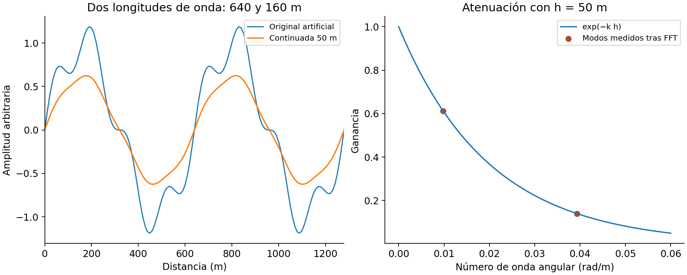

# 9. FFT, continuación, derivadas y análisis espectral

[English](../en/09_fft_espectros.md) · [Español](../es/09_fft_espectros.md) · [Português](../pt/09_fft_espectros.md)

## Muestreo y preparación

La FFT 2D requiere un raster regular y unidades horizontales coherentes. frequency_grid devuelve números de onda angulares kx, ky y su módulo, en radianes por unidad de longitud. No introducir ciclos por metro donde se esperan radianes por metro. La frecuencia de Nyquist es 1/(2Δx) en ciclos por longitud; el tamaño de celda limita la representación de ondas cortas.

prepare_fft_grid puede quitar media o plano, reflejar bordes, aplicar taper fuera del área original y tratar huecos según una política explícita. Su estado se entrega a finish_fft_grid para recortar, recuperar máscara y, si corresponde, restaurar tendencia. Un relleno nearest facilita el cálculo espectral, pero no convierte huecos en mediciones.

## Operadores elementales

### Vista previa en vivo y colores

La ventana de entrada se reutiliza al editar parámetros. Cambiar la extensión, la banda, la fuente o la fecha de modificación del archivo invalida esa caché de una sola ventana.

Activa Vista previa en vivo en la Pila de filtros. Los cambios y la navegación esperan 300 ms; un único hilo cancela solicitudes obsoletas y publica solo el resultado vigente. Una capa temporal Vista previa representa la pila hasta el filtro seleccionado. F6 alterna antes/después. Desactivar la casilla o cerrar el panel retira la capa. Aplicar ejecuta toda la pila a resolución nativa con procedencia.

La lectura cubre la extensión visible con un margen de observaciones del 50% por lado, recortado a la fuente, a resolución de pantalla (máximo 512 muestras por lado visible). Los filtros FFT conservan su reflexión y taper; otras pilas reciben un margen adicional reflejado con taper. Las longitudes regionales, los cortes bruscos y una RTP inestable pueden depender de observaciones externas a la ventana. Compara el resultado nativo antes de interpretar.

Ajustar colores (GeoRamp) abre paletas científicas e histogramas interactivos para la vista previa o la entrada. Los productos magnéticos usan classic_geophysics; derivadas con signo y tilt usan blue_white_red con límites simétricos respecto de cero. Instalar GeoRamp abre su ficha en el gestor cuando falta. QGIS resuelve la dependencia declarada GeoRamp; desde ZIP puede requerirse instalarla por separado.

    Continuación ascendente: H(k,h) = exp(−k h), h > 0
    Derivada en X: Hx = i kx
    Derivada en Y: Hy = i ky

La derivada vertical necesita la convención vertical de la API. No trasladar el signo de z positivo hacia abajo a una malla positiva hacia arriba por simple semejanza de nombres. Las derivadas amplifican altas frecuencias y deben evaluarse junto al ruido.

Figura 3. Demostración con una señal artificial periódica de dos longitudes de onda. Los puntos son la transferencia calculada con las funciones del Core; las curvas no representan un survey ni una comparación entre motores.

## Selección de transferencia

Butterworth permite transiciones graduales; filtros ideales producen transiciones abruptas y pueden introducir oscilaciones. Los filtros direccionales requieren azimut y ancho angular. El notch puede retirar interferencia y señal a la vez. Una transferencia radial tabulada necesita números de onda crecientes desde cero y un presupuesto explícito de ganancia; retiene la última ganancia por encima del último nudo tabulado.

La continuación descendente utiliza una ganancia creciente de ondas cortas y es inestable sin regularización. El estabilizador y el máximo de ganancia son parte del método. La integración tiene singularidad en frecuencia nula o sobre ejes; registrar qué modos se anulan o estabilizan. No restaurar una tendencia después de una derivada o un pasa-altas solo porque el helper lo permita.

## Espectros e interpretación

radial_power_spectrum y spectral_analysis ofrecen PSD, agrupación y ajustes de profundidad. Revisar detrend, normalización, anillos o sectores, rango de k y número de muestras en cada bin. Una pendiente espectral depende del modelo de fuentes y del intervalo ajustado: el error de regresión no equivale a incertidumbre geológica de profundidad.

matched_layer_filters, Wiener y coherencia/admitancia utilizan modelos, ruido o capas prescritas. No deducen por sí solos la geometría correcta. Las herramientas de preparación histórica identificadas en la referencia mantienen compatibilidad de recetas; sus nombres no prueban equivalencia con otros programas.

Ver [análisis espectral y alcance](../../research/core_expansion_implementation.md), [filtros radiales](../../reference/methods/magnetic_component_api.md) y el [manual práctico](../../handbook/handbook_es.md).

## Implementación relacionada

[spectral](../../../terraworkbench_core/spectral.py), [spectral_analysis](../../../terraworkbench_core/spectral_analysis.py), [radial_filters](../../../terraworkbench_core/radial_filters.py), [filter_recipes](../../../terraworkbench_core/filter_recipes.py), [classic_style](../../../terraworkbench_core/classic_style.py)

---

[Índice](README.md) · [Anterior](08_filtros_espaciales.md) · [Siguiente](10_magnetometria.md)
