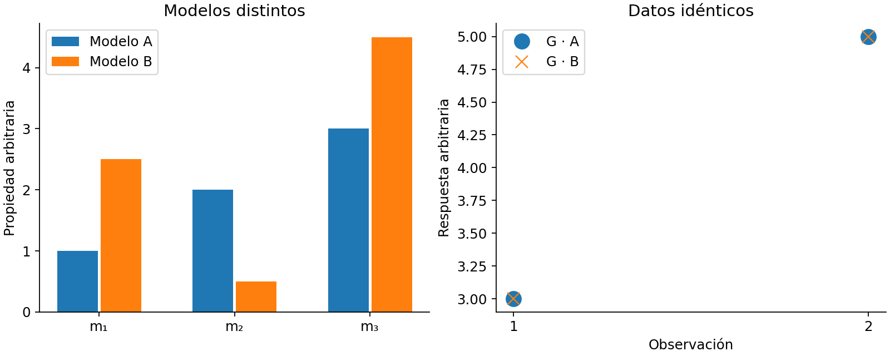

# 17. Convergencia, resolución, incertidumbre y validación

[English](../en/17_resolucion_incertidumbre.md) · [Español](../es/17_resolucion_incertidumbre.md) · [Português](../pt/17_resolucion_incertidumbre.md)

## Separar cuatro resultados

| Resultado | Qué demuestra | Qué no demuestra |
| --- | --- | --- |
| Archivos completos | Finalización y publicación del flujo | Corrección física |
| Solver interno preciso | Sistema numérico resuelto con la tolerancia auditada | Objetivo externo alcanzado |
| Buen ajuste de observaciones | Compatibilidad con datos y sigma elegidos | Modelo único o verdadero |
| Recuperación independiente | Cumplimiento de un criterio definido frente a una referencia | Validez universal fuera de ese dominio |

Un error voxel elevado con ajuste pequeño puede reflejar no unicidad, sensibilidad débil, regularización o errores del experimento. No atribuirlo automáticamente a un bug, ni descartar una implementación sin verificar operadores, unidades, índices activos y geometría.

Figura 4. Ejemplo lineal artificial con más parámetros que observaciones. Dos modelos diferentes producen los mismos datos dentro de precisión numérica. Ilustra el concepto de espacio nulo; no reproduce un experimento geofísico de campo.

## Lectura de diagnósticos

weighted_rms y target_reached describen el criterio de datos. iterations e iteration_limit_reached describen presupuesto externo. Las métricas CG registran precisión del solve interno y, donde corresponde, tolerancias crudas y escaladas. Una salida no convergida debe permanecer como tal, aunque exista VTK o una imagen plausible.

Revisar también celdas en cotas, cambio relativo de modelo, beta, normas y residuo espacial. Un modelo que toca límites puede necesitar análisis de sensibilidad; aumentar las cotas hasta mejorar el holdout convierte ese holdout en datos de selección de receta.

## Herramientas de resolución

inversion_diagnostics ofrece controles L2 lineales, partición de error, resolución y DOI respecto a referencias. matrix_free_resolution calcula estimaciones estocásticas y funciones de dispersión puntual con presupuesto explícito. Son análisis bajo operador, pesos y regularización fijados; no incertidumbre no lineal completa con geología libre.

linear_gaussian_ensemble representa un problema lineal gaussiano con prior definido. No es el posterior de una inversión con restricciones, IRLS, malla adaptativa o selección de beta reinterpretada como aleatoria. La covarianza condicional debe presentarse con ese alcance.

## Diseñar una campaña

1. Verificar forward con fuentes analíticas y un motor independiente.
2. Comparar índices activos, signos, unidades y exportación.
3. Fijar recetas y criterios antes de observar resultados reservados.
4. Reservar líneas, bloques o un survey completo según la pregunta.
5. Variar resolución, inicialización y supuestos en entrenamiento.
6. Evaluar al final el conjunto reservado y conservar fallos.

spatial_holdout y training_plane ayudan a separar selección y ajuste, pero un holdout intercalado dentro del mismo survey puede ser optimista. model_recovery_metrics requiere un modelo verdadero y máscaras compatibles; no crear una verdad geológica a partir del mismo modelo recuperado.

Ver [convergencia y resolución](../../validation/reports/inversion_convergence_resolution.md), [benchmark público](../../validation/reports/public_inversion_benchmark.md), [recuperación voxel](../../validation/reports/voxel_recovery_validation.md) y [evidencia MVI](../../validation/reports/mvi_reference_validation.md).

## Implementación relacionada

[inversion_diagnostics](../../../terraworkbench_core/inversion_diagnostics.py), [inversion_evidence](../../../terraworkbench_core/inversion_evidence.py), [matrix_free_resolution](../../../terraworkbench_core/matrix_free_resolution.py), [recovery_metrics](../../../terraworkbench_core/recovery_metrics.py), [advanced_statistics](../../../terraworkbench_core/advanced_statistics.py), [_calibration](../../../terraworkbench_core/_calibration.py)

---

[Índice](README.md) · [Anterior](16_mvi_conjunta.md) · [Siguiente](18_electrica_dc.md)
