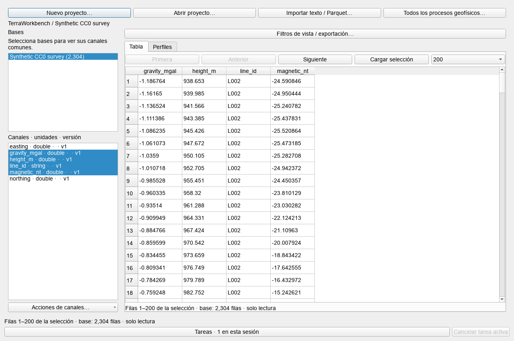
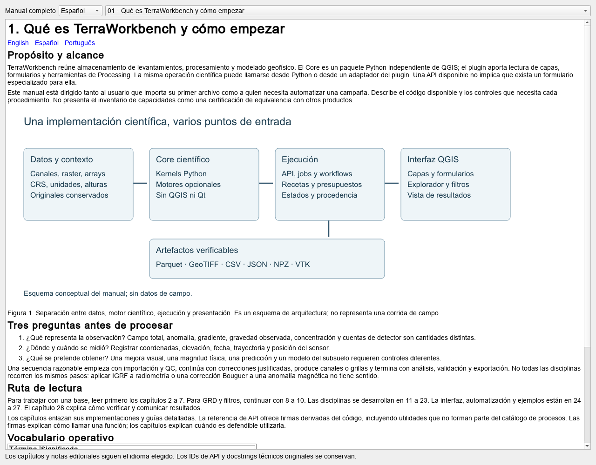

# 24. Interfaz QGIS, formularios, idiomas y capturas

[English](../en/24_gui_qgis.md) · [Español](../es/24_gui_qgis.md) · [Português](../pt/24_gui_qgis.md)

## Entradas de la interfaz

En QGIS, abrir Raster → TerraWorkbench → Procesos geofísicos. Desde el mismo menú se accede al explorador de bases, la pila de filtros, dependencias y base de conocimiento. La redacción visible depende del idioma elegido y de la versión del host.

El centro de procesos reúne el proveedor QGIS y el catálogo avanzado del Core. El explorador de surveys permite abrir workspaces, seleccionar bases y canales, previsualizar páginas, aplicar filtros de vista y consultar perfiles. El dock de filtros trabaja sobre raster. Estos espacios no representan el mismo tipo de dato ni comparten todos los parámetros.

La disponibilidad se verifica por proceso. Algunas APIs tienen formulario especializado; otras utilizan el editor avanzado de argumentos. Un método que existe en un módulo pero no en el registro sigue requiriendo Python u orquestación explícita.

## Flujo con una grilla

1. Importar GRD u otro raster y revisar la conversión de trabajo.
2. Confirmar capa, unidades, SRC y máscara.
3. Elegir una operación y revisar sus parámetros.
4. Ejecutar a una salida nueva; inspeccionar diferencias y bordes.
5. Guardar receta y productos necesarios para repetir la secuencia.

La carpeta vacía puede usar temporales del procesamiento. Una carpeta elegida crea un contexto de ejecución y permite conservar receta e intermedios según la herramienta. La receta no certifica que la siguiente ejecución recibió los mismos bytes de entrada.

## Formularios avanzados

Los formularios se construyen a partir de firmas reales, etiquetas escritas en tres idiomas y validadores. Un argumento obligatorio sin valor físico no se inventa. Las matrices pueden venir de un NPZ mediante @nombre o un objeto $array en JSON. Revisar forma, dtype, unidades y longitud antes de ejecutar; el inspector de cabeceras no carga ni valida toda la física de los arrays.

El NPZ no admite objetos con pickle. Los parámetros tienen presupuestos de JSON y arrays, y los trabajos guardan manifest.json y arrays.npz. Los errores originales de motores pueden estar en inglés. Los identificadores de API, claves de receta y nombres de canales permanecen estables al cambiar idioma.

## Capturar sin controlar el escritorio

ui.evidence_api necesita un QApplication real con plataforma offscreen. Aislar perfil y QSettings antes de construir widgets para no cambiar preferencias del usuario. capture_widget guarda el widget real a un PNG nuevo; capture_workspace abre la base existente y espera el preview. Se rechazan plataformas de escritorio y sobrescrituras.

Figura 5. Captura offscreen real de los datos sintéticos CC0 incluidos. Documenta la integración de base e interfaz con valores artificiales, sin inversión de un levantamiento de campo ni validación geológica. El nombre histórico de la imagen se conserva por compatibilidad de enlaces.

Un render offscreen no sustituye pruebas de accesibilidad, interacción y comportamiento visual en cada escritorio soportado. Tampoco necesita abrir una ventana visible para ejecutar el motor.

Ver [guía del workbench](../../guides/geophysical_workbench_gui.md), [localización](../../guides/localization.md), [API de capturas](../../guides/api_evidence.md) y [catálogo QGIS](../../reference/catalogues/qgis.md).

Figura 6. Lector real de los 28 capítulos, capturado mediante API offscreen. El idioma del lector no cambia las preferencias globales del usuario.

---

[Índice](README.md) · [Anterior](23_integracion_experimentos.md) · [Siguiente](25_api_workflows.md)
