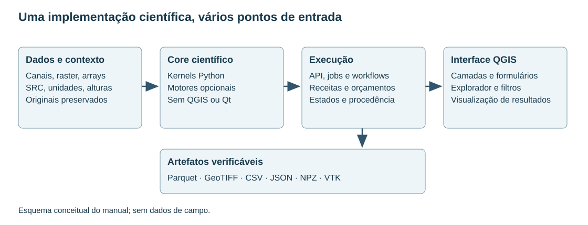

# 1. O que é o TerraWorkbench e como começar

[English](../en/01_inicio.md) · [Español](../es/01_inicio.md) · [Português](../pt/01_inicio.md)

## Objetivo e alcance

O TerraWorkbench reúne armazenamento de levantamentos, processamento e modelagem geofísica. O Core é um pacote Python independente do QGIS; o plugin fornece leitura de camadas, formulários e ferramentas de Processing. A mesma operação científica pode ser chamada por Python ou por um adaptador do plugin. Uma API disponível não significa que exista um formulário especializado para ela.

Este manual atende tanto quem importa o primeiro arquivo quanto quem precisa automatizar uma campanha. Descreve o código disponível e os controles necessários em cada procedimento. O inventário de capacidades não é uma certificação de equivalência com outros produtos.

Figura 1. Separação entre dados, motor científico, execução e apresentação. É um esquema de arquitetura, não uma execução com dados de campo.

## Três perguntas antes de processar

1. O que representa a observação? Campo total, anomalia, gradiente, gravidade observada, concentração e contagens do detector são grandezas diferentes.
2. Onde e quando foi medida? Registrar coordenadas, elevação, data, trajetória e posição do sensor.
3. Qual resultado se pretende obter? Realce visual, grandeza física, previsão e modelo do subsolo exigem controles diferentes.

Uma sequência razoável começa com importação e QC, continua com correções justificadas, produz canais ou grades e termina com análise, validação e exportação. As disciplinas não seguem os mesmos passos: aplicar IGRF à radiometria ou correção de Bouguer a uma anomalia magnética não tem sentido físico.

## Roteiro de leitura

Para trabalhar com uma base, ler primeiro os capítulos 2 a 7. Para GRD e filtros, continuar com 8 a 10. As disciplinas são desenvolvidas em 11 a 23. Interface, automação e exemplos estão em 24 a 27. O capítulo 28 explica como verificar e comunicar resultados.

Os capítulos apontam para implementações e guias detalhados. A referência de API deriva assinaturas do código, incluindo utilitários fora do catálogo de processos. As assinaturas explicam como chamar uma função; os capítulos explicam quando seu uso é justificável.

## Vocabulário de trabalho

| Termo | Significado |
| --- | --- |
| Canal | Variável alinhada às linhas de uma base |
| Versão | Conteúdo de canal identificado de maneira imutável |
| Grade | Valores em uma malha regular georreferenciada |
| Receita | Parâmetros e sequência explícita de operações |
| Linhagem | Dependências entre versões de entrada e saída |
| QC | Controles de integridade e qualidade das observações |
| Validação | Evidência de atendimento a critérios definidos para um uso |

Consultar também a [estrutura do repositório](../../development/repository_structure.md) e a [política de evidência](../../handbook/README.md).

## Implementação relacionada

[__init__](../../../terraworkbench_core/__init__.py)

---

[Índice](README.md) · [Próximo](02_instalacion.md)
