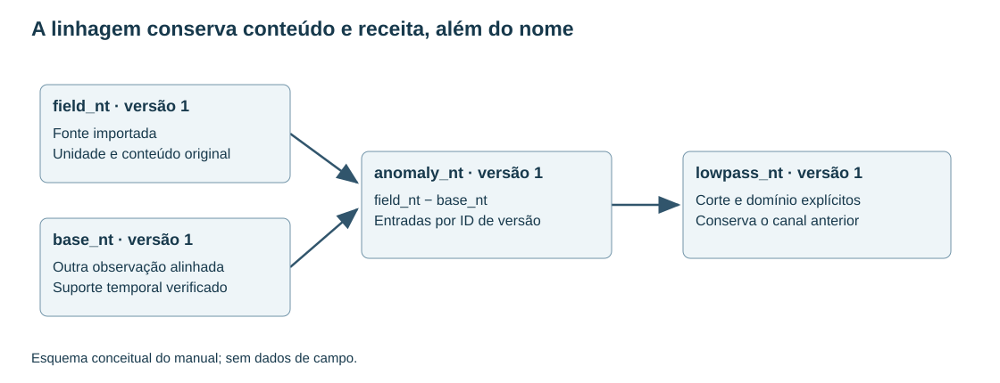

# 5. Workspaces, canais, versões e linhagem

[English](../en/05_bases_canales.md) · [Español](../es/05_bases_canales.md) · [Português](../pt/05_bases_canales.md)

## Modelo de armazenamento

SurveyStore combina catálogo SQLite e arquivos Parquet imutáveis. O catálogo identifica bases, canais, versões e eventos. Parquet permite ler por colunas e lotes; processar uma variável não exige carregar todos os canais. O workspace é uma unidade de trabalho, não um arquivo GDB proprietário.

A base preserva alinhamento de linhas. Selecionar colunas não o altera. Máscaras e filtros de visualização restringem consultas, sem reordenar automaticamente a aquisição. A geometria armazenada identifica canais XY e SRC, sem transformar coordenadas.

## Primeira base pela interface

Abrir **Bancos de dados…** na Pilha de filtros ou **Bancos de levantamentos…** no menu Raster do QGIS. Se a camada ativa pertence a um levantamento, o explorador seleciona seu banco. Após importar texto ou uma GDB, clicar em **Abrir banco de dados** na barra de mensagens do QGIS para abrir o banco importado na primeira linha. Criar um workspace em uma pasta vazia e revisar o assistente de texto antes de aceitar.

Selecionar um banco abre uma planilha somente leitura com todos os canais. Linha, fiducial ou tempo, X e Y vêm primeiro. Os demais seguem a ordem do banco. Os cabeçalhos mostram as unidades e a dica exibe origem, tipo e versão. A busca e as setas percorrem as linhas na ordem de ocorrência. O papel de linha atribuído tem prioridade sobre a detecção pelo nome. O botão do canal de linha permite alterá-lo. A planilha lê pequenos lotes durante a rolagem. **Todas as linhas** usa páginas e os filtros de visualização existentes.

Usar **Colunas…** ou o menu de contexto do cabeçalho para mudar a visibilidade. A configuração é lembrada para cada banco. As ações usam uma coluna da planilha ou a seleção lateral. **Perfis** acompanha a linha e os canais numéricos marcados. Clicar em uma linha da planilha marca a posição da amostra. Preservar a pasta completa do workspace ao fazer cópias dos produtos.

Figura 2. Fontes e canais derivados em um exemplo conceitual. A versão de entrada, além do nome, determina o conteúdo processado.

## Adicionar um levantamento ao mapa do QGIS

No assistente de texto, revise as funções X, Y e linha opcional e escolha o SRC de origem se estiver ausente. Com as coordenadas e o SRC conhecidos, o TerraWorkbench adiciona automaticamente um grupo. A ação **Adicionar levantamento ao mapa…** permite reconstruir o grupo com uma seleção filtrada ou atribuir coordenadas e SRC em um único diálogo.

O grupo inclui Linhas de voo, Linhas de controle quando disponíveis, Limite do levantamento e Amostras. Os rótulos das extremidades aparecem ao aproximar o mapa. Amostras inicia desligada e tem seu próprio limite de escala. Sem canal de linha, são criados apenas Amostras e Limite do levantamento. O GeoPackage é salvo em results do workspace. [Regras de geometria e classificação](../../development/survey_map_layers.md).

As linhas de voo são cinza-escuro e as de controle são laranja-escuro. Ambas têm halo branco e mostram setas no sentido de aquisição a 1:150.000 ou mais perto. As outras linhas são pontilhadas. O limite tem dois traços, branco e verde-azulado, com um brilho interno que se torna transparente.

## Criar uma variável derivada

Nomear primeiro grandeza e unidade: mag_anomaly_nt, gravity_complete_bouguer_mgal ou sensor_height_m. Acrescentar o passo distintivo para alternativas, como mag_anomaly_lowpass_nt. O rótulo não substitui parâmetros registrados.

A fórmula usa linguagem aritmética restrita. Por exemplo, c("field_nt") − c("main_field_nt") subtrai canais alinhados. Não é um interpretador Python geral e não deve executar imports ou instruções externas.

A derivação conserva versões de entrada. Se o conteúdo mudou após a revisão da receita, parar e revisar novamente. Duplicar um canal pode criar alias da mesma versão imutável sem copiar todos os bytes; versões futuras evoluem independentemente.

## Publicar cálculos externos

publish_channels recebe arrays com o mesmo número de linhas da base, uma unidade por saída, versões exatas dos canais utilizados e procedência com o nome da operação. Os nomes precisam ser novos. As saídas são publicadas juntas em transação; NaN vira nulo, enquanto infinitos ou comprimentos incompatíveis são rejeitados.

Registrar parameters, libraries e engine mostra parâmetros, bibliotecas e motor no inspetor de linhagem. Incluir topografia, campo indutor e seleção quando participarem, mesmo que não apareçam diretamente na fórmula final.

## Capacidade e segurança

A capacidade total da base difere do limite do filtro por trecho. O filtrado de canais aceita até três milhões de amostras por trecho contínuo, sujeito aos demais orçamentos. Uma base com várias linhas pode ter mais registros. Não concatenar linhas para contornar os controles de continuidade.

O orçamento de arrays publicados limita seu tamanho float64 combinado; não limita toda a RAM nem inclui buffers do motor. Separar originais de derivados e fazer backup coerente de catálogo e Parquet.

Ver [workspaces](../../guides/survey_workspaces.md), [explorador](../../guides/survey_explorer.md) e [contratos de evidência](../../guides/api_evidence.md).

## Implementação relacionada

[survey_store](../../../terraworkbench_core/survey_store.py), [survey_explorer](../../../terraworkbench_core/survey_explorer.py), [survey_recipes](../../../terraworkbench_core/survey_recipes.py)

---

[Índice](README.md) · [Anterior](04_importacion.md) · [Próximo](06_perfiles_qc.md)
