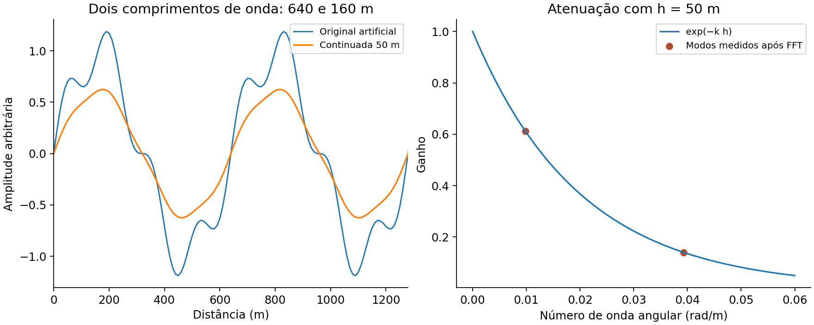

# 9. FFT, continuação, derivadas e análise espectral

[English](../en/09_fft_espectros.md) · [Español](../es/09_fft_espectros.md) · [Português](../pt/09_fft_espectros.md)

## Amostragem e preparação

A FFT 2D exige raster regular e unidades horizontais coerentes. frequency_grid retorna números de onda angulares kx, ky e seu módulo, em radianos por unidade de comprimento. Não fornecer ciclos/m quando se esperam rad/m. A frequência de Nyquist é 1/(2Δx) em ciclos por comprimento; a célula limita ondas curtas representáveis.

prepare_fft_grid pode retirar média/plano, refletir bordas, aplicar taper fora da área original e tratar lacunas segundo política explícita. Seu estado passa a finish_fft_grid para recorte, recuperação de máscara e eventual restauração da tendência. Preenchimento nearest permite o cálculo, mas não transforma lacunas em medidas.

## Operadores elementares

    Continuação ascendente: H(k,h) = exp(−k h), h > 0
    Derivada em X: Hx = i kx
    Derivada em Y: Hy = i ky

A derivada vertical depende da convenção da API. Não transferir o sinal de z positivo para baixo a uma malha positiva para cima apenas por semelhança de nomes. Derivadas amplificam altas frequências e devem ser avaliadas junto do ruído.

Figura 3. Sinal artificial periódico de dois comprimentos de onda. Os pontos mostram a transferência medida após processamento pelo Core; as curvas não representam levantamento nem comparação independente entre motores.

## Escolha da transferência

Butterworth permite transições graduais; filtros ideais têm transições abruptas e podem gerar oscilações. Filtros direcionais precisam de azimute e largura angular. Notch pode retirar interferência e sinal. Uma transferência radial tabelada exige números de onda crescentes desde zero e orçamento explícito de ganho; o último ganho é mantido acima do último nó.

A continuação descendente amplifica progressivamente ondas curtas e é instável sem regularização. Estabilizador e ganho máximo são parte do método. A integração é singular no modo zero ou nos eixos; registrar quais modos são retirados/estabilizados. Não restaurar tendência após derivada ou passa-altas apenas porque um helper permite.

## Espectros e interpretação

radial_power_spectrum e spectral_analysis oferecem PSD, agrupamento e ajustes de profundidade. Verificar detrend, normalização, anéis/setores, intervalo de k e amostras por bin. A inclinação espectral depende do modelo de fontes e intervalo ajustado: erro de regressão não é incerteza geológica de profundidade.

matched_layer_filters, Wiener e coerência/admitância usam modelos, ruído ou camadas prescritas; não descobrem sozinhos a geometria correta. Helpers históricos de preparação preservam compatibilidade de receitas; os nomes não provam equivalência com outros programas.

Ver [análise espectral e alcance](../../research/core_expansion_implementation.md), [filtros radiais](../../reference/methods/magnetic_component_api.md) e [manual prático](../../handbook/handbook_pt.md).

## Implementação relacionada

[spectral](../../../terraworkbench_core/spectral.py), [spectral_analysis](../../../terraworkbench_core/spectral_analysis.py), [radial_filters](../../../terraworkbench_core/radial_filters.py), [filter_recipes](../../../terraworkbench_core/filter_recipes.py), [oasis_style](../../../terraworkbench_core/oasis_style.py)

---

[Índice](README.md) · [Anterior](08_filtros_espaciales.md) · [Próximo](10_magnetometria.md)
