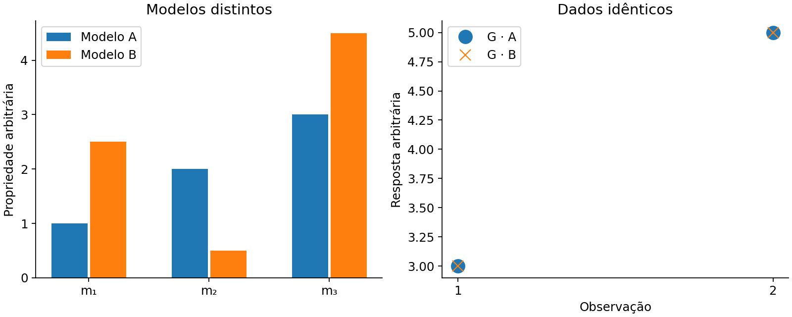

# 17. Convergência, resolução, incerteza e validação

[English](../en/17_resolucion_incertidumbre.md) · [Español](../es/17_resolucion_incertidumbre.md) · [Português](../pt/17_resolucion_incertidumbre.md)

## Separar quatro resultados

| Resultado | Demonstra | Não demonstra |
| --- | --- | --- |
| Arquivos completos | Conclusão/publicação do fluxo | Correção física |
| Solver interno preciso | Sistema resolvido na tolerância auditada | Objetivo externo atingido |
| Bom ajuste de observações | Compatibilidade com dados/sigma escolhidos | Modelo único ou verdadeiro |
| Recuperação independente | Critério definido atendido contra referência | Validade universal fora desse domínio |

Erro voxel elevado com desajuste pequeno pode refletir não unicidade, baixa sensibilidade, regularização ou erros experimentais. Não atribuir automaticamente a bug nem rejeitar implementação sem verificar operadores, unidades, índices ativos e geometria.

Figura 4. Problema linear artificial com mais parâmetros que observações. Modelos distintos produzem dados iguais dentro da precisão numérica. Ilustra espaço nulo, não um experimento geofísico de campo.

## Ler diagnósticos

weighted_rms e target_reached descrevem o critério de dados. iterations e iteration_limit_reached descrevem orçamento externo. Métricas CG registram precisão interna e, quando pertinente, tolerâncias brutas/escaladas. Uma saída não convergida continua não convergida mesmo que exista VTK ou imagem plausível.

Examinar também células nos limites, mudança relativa, beta, normas e resíduos espaciais. Um modelo que toca limites pode precisar de sensibilidade; aumentar cotas até melhorar o erro reservado transforma a reserva em informação de seleção de receita.

## Ferramentas de resolução

inversion_diagnostics oferece controles L2 lineares fixos, partição de erro, resolução e DOI em relação a referências. matrix_free_resolution calcula estimativas estocásticas e funções de espalhamento pontual com orçamento. Condicionam-se a operador, pesos e regularização fixos; não são incerteza não linear completa com geologia livre.

linear_gaussian_ensemble descreve problema linear gaussiano com prior definido. Não é posterior de inversão com restrições, IRLS, malha adaptativa ou seleção de beta reinterpretada como aleatória. Apresentar a covariância condicional com esse alcance.

## Desenhar uma campanha

1. Verificar cálculo direto com fontes analíticas e motor independente.
2. Comparar índices ativos, sinais, unidades e exportação.
3. Fixar receitas/critérios antes de observar resultados reservados.
4. Reservar linhas, blocos ou levantamento completo conforme a pergunta.
5. Variar resolução, início e hipóteses no treinamento.
6. Avaliar a reserva ao final e preservar falhas.

spatial_holdout e training_plane separam seleção e ajuste, mas reserva intercalada no mesmo levantamento pode ser otimista. model_recovery_metrics exige modelo verdadeiro e máscaras compatíveis; não criar verdade geológica a partir do próprio modelo recuperado.

Ver [convergência/resolução](../../validation/reports/inversion_convergence_resolution.md), [benchmark público](../../validation/reports/public_inversion_benchmark.md), [recuperação voxel](../../validation/reports/voxel_recovery_validation.md) e [evidência MVI](../../validation/reports/mvi_reference_validation.md).

## Implementação relacionada

[inversion_diagnostics](../../../terraworkbench_core/inversion_diagnostics.py), [inversion_evidence](../../../terraworkbench_core/inversion_evidence.py), [matrix_free_resolution](../../../terraworkbench_core/matrix_free_resolution.py), [recovery_metrics](../../../terraworkbench_core/recovery_metrics.py), [advanced_statistics](../../../terraworkbench_core/advanced_statistics.py), [_calibration](../../../terraworkbench_core/_calibration.py)

---

[Índice](README.md) · [Anterior](16_mvi_conjunta.md) · [Próximo](18_electrica_dc.md)
