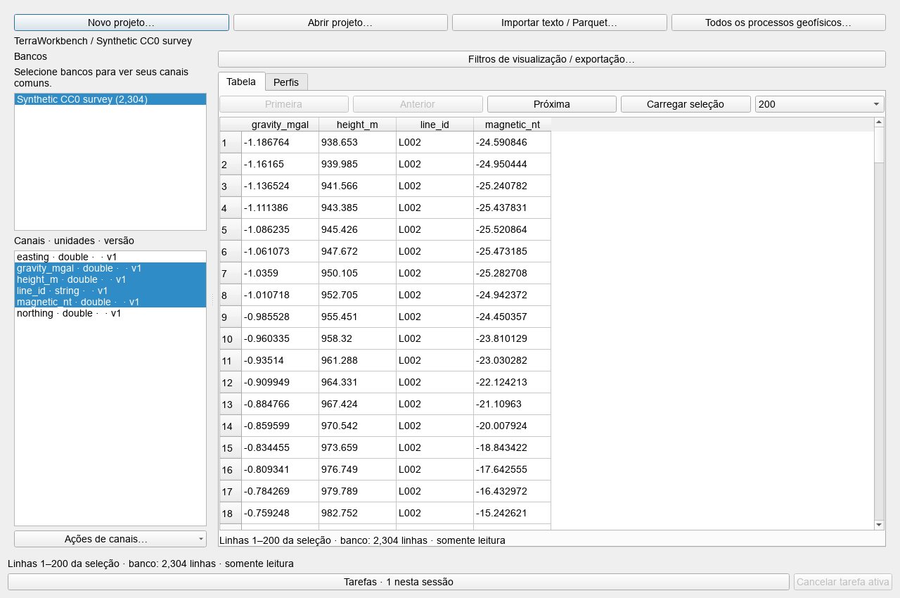
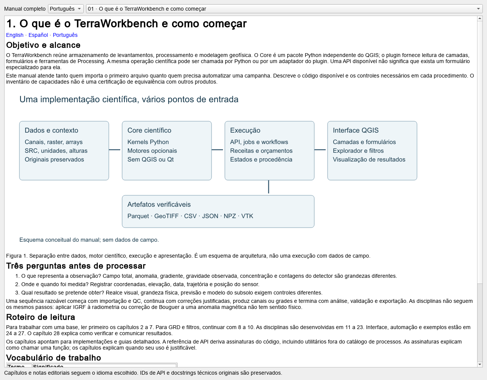

# 24. Interface QGIS, formulários, idiomas e capturas

[English](../en/24_gui_qgis.md) · [Español](../es/24_gui_qgis.md) · [Português](../pt/24_gui_qgis.md)

## Entradas da interface

No QGIS, abrir Raster → TerraWorkbench → Processos geofísicos. O mesmo menu oferece explorador de bases, pilha de filtros, dependências e base de conhecimento. A redação visível depende do idioma e da versão do host.

O centro de processos reúne provedor QGIS e catálogo avançado do Core. O explorador abre workspaces, seleciona bases/canais, mostra páginas e perfis e aplica filtros de visualização. O dock de filtros trabalha com raster. Esses espaços não representam os mesmos tipos de dado nem compartilham todos os parâmetros.

A disponibilidade é específica por processo. Algumas APIs têm formulário próprio; outras usam editor avançado. Uma função fora do registro ainda exige Python ou coordenação explícita.

## Fluxo com uma grade

1. Importar GRD ou outro raster e revisar a conversão de trabalho.
2. Confirmar camada, unidades, SRC e máscara.
3. Escolher operação e revisar parâmetros.
4. Executar para nova saída; inspecionar diferenças e bordas.
5. Salvar receita e produtos para repetir a sequência.

Pasta de saída vazia pode usar temporários de Processing. Uma pasta escolhida cria contexto de execução e preserva receita/intermediários conforme a ferramenta. Receita não certifica que a próxima execução recebeu os mesmos bytes.

## Formulários avançados

Formulários usam assinaturas reais, rótulos escritos nos três idiomas e validadores. Valores físicos obrigatórios não são inventados. Arrays podem vir de NPZ por @nome ou objeto JSON $array. Revisar forma, dtype, unidades e comprimento; inspecionar cabeçalho não carrega nem valida toda a física.

NPZ não permite objetos pickle. Existem orçamentos de JSON/arrays e os trabalhos conservam manifest.json e arrays.npz. Erros originais dos motores podem estar em inglês. IDs de API, chaves de receitas e nomes dos canais permanecem estáveis ao mudar idioma.

## Capturar sem controlar a área de trabalho

ui.evidence_api exige QApplication real na plataforma offscreen. Isolar perfil e QSettings antes dos widgets evita alterar preferências do usuário. capture_widget salva widget real em PNG novo; capture_workspace abre base existente e espera a pré-visualização. Plataformas desktop e sobrescritas são rejeitadas.

Figura 5. Captura offscreen real dos dados sintéticos CC0 incluídos. Documenta integração da base com a interface usando valores artificiais, sem inversão de levantamento de campo nem validação geológica. O nome histórico da imagem permanece para compatibilidade dos links.

Renderização offscreen não substitui testes de acessibilidade, interação e apresentação em cada desktop suportado. O motor não precisa de uma janela visível para executar.

Ver [guia da interface](../../guides/geophysical_workbench_gui.md), [localização](../../guides/localization.md), [API de capturas](../../guides/api_evidence.md) e [catálogo QGIS](../../reference/catalogues/qgis.md).

Figura 6. Leitor real dos 28 capítulos capturado pela API offscreen. O idioma do leitor não altera as preferências globais do usuário.

---

[Índice](README.md) · [Anterior](23_integracion_experimentos.md) · [Próximo](25_api_workflows.md)
