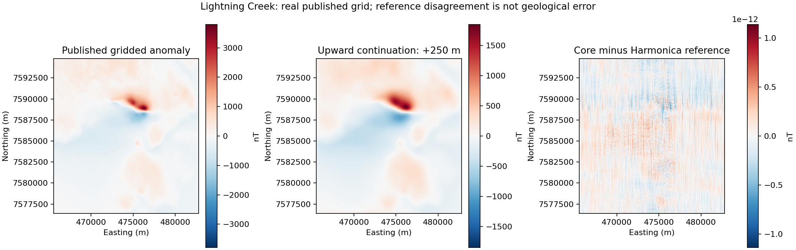
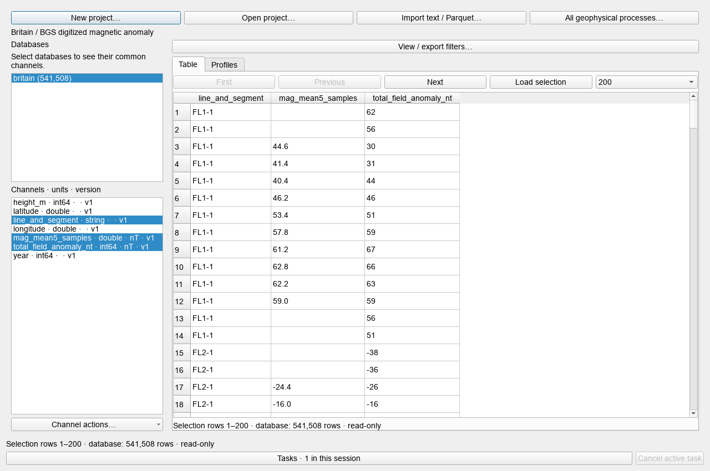

# Frozen reproducibility replay: results

[Paper index](../README.md)

This replay uses previously explored datasets. It is not new blind confirmation. All attempted outcomes are retained; reference disagreement, data prediction and model recovery have different meanings.

Protocol: TW-PAPER-REPLAY-1.0. Execution source: a4bc358c85975a7ef8284f77cf977c769ba956be.

[Complete current record](campaign.json) · [Current metric index](current_metrics.csv) · [Historical registry](historical_registry.json) · [All indexed historical metrics](historical_metrics.csv)

## Primary real-data workflows

| Workflow | Status | Scope |
| --- | --- | --- |
| gravity | passed | Published disturbance plus explicit land slab recipe. No field validation of full terrain, tides or atmospheric corrections. Southern Africa horizontal datum is unspecified by publisher; no reprojection applied. |
| magnetic | passed | Periodic FFT, no detrend, taper or padding. Reference Harmonica independently constructs transfers. Directions are declared numerical stress cases, not recovered acquisition parameters. |
| interpolation | passed | Interpolation diagnostics on a withheld block of an already interpolated public grid. Finite-output and declared solver-convergence checks only; no predeclared scientific accuracy acceptance and no raw-survey ground truth. |
| terrain | passed | ETOPO1 coastal DEM projected to a finite Cartesian model. Independent Geoana prism reference, explicit upward/downward and SI/mGal conversion. Bounds cover tree truncation only. Airy finite and periodic conditions checked separately; no geologically calibrated isostatic residual. |
| survey | passed | All digitized rows; sample-domain smoothing split by published contiguous IDs. Irregular contour samples are not treated as uniformly spaced distance or time. |
| radiometry | passed | Published corrected concentrations only. No inverse recovery of undocumented calibration coefficients, no validation of atmospheric radon correction. Archive/report label and date channels are recorded as published, without repairing their discrepancy. |

## Numerical comparisons and interpolation diagnostics

| JSON pointer | RMS/error value | Unit | Meaning |
| --- | ---: | --- | --- |
| /outcomes/processing/cases/gravity/published_bushveld/rms_error | 4.110544e-09 | mGal | Reference-operator disagreement |
| /outcomes/processing/cases/gravity/southern_reduction/rms_error | 3.9971976e-06 | mGal | Reference-operator disagreement |
| /outcomes/processing/cases/gravity/grs80_surface/rms_error | 3.9971976e-06 | mGal | Reference-operator disagreement |
| /outcomes/processing/cases/magnetic/comparisons/upward_50m/rms_error | 1.8255295e-13 | nT | Reference-operator disagreement |
| /outcomes/processing/cases/magnetic/comparisons/upward_250m/rms_error | 1.449712e-13 | nT | Reference-operator disagreement |
| /outcomes/processing/cases/magnetic/comparisons/upward_1000m/rms_error | 8.0533628e-14 | nT | Reference-operator disagreement |
| /outcomes/processing/cases/magnetic/comparisons/upward_derivative_1/rms_error | 6.5547214e-15 | nT/m | Reference-operator disagreement |
| /outcomes/processing/cases/magnetic/comparisons/upward_derivative_2/rms_error | 3.7012202e-16 | nT/m^2 | Reference-operator disagreement |
| /outcomes/processing/cases/magnetic/comparisons/rtp_-55_12/rms_error | 2.923789e-13 | nT | Reference-operator disagreement |
| /outcomes/processing/cases/magnetic/comparisons/rtp_55_-20/rms_error | 3.0742433e-13 | nT | Reference-operator disagreement |
| /outcomes/processing/cases/magnetic/comparisons/rtp_-15_80/rms_error | 1.7177891e-12 | nT | Reference-operator disagreement |
| /outcomes/processing/cases/magnetic/comparisons/binomial_interior/rms_error | 0 | nT | Reference-operator disagreement |
| /outcomes/processing/cases/interpolation/metrics/linear_scipy/rms_nt | 2.5368812 | nT | Prediction against already gridded input; descriptive, not geological truth |
| /outcomes/processing/cases/interpolation/metrics/global_tps/rms_nt | 1.8658768 | nT | Prediction against already gridded input; descriptive, not geological truth |
| /outcomes/processing/cases/interpolation/metrics/local_tps_32/rms_nt | 1.8112554 | nT | Prediction against already gridded input; descriptive, not geological truth |
| /outcomes/processing/cases/interpolation/metrics/minimum_curvature_multilevel/rms_nt | 1.8814068 | nT | Prediction against already gridded input; descriptive, not geological truth |
| /outcomes/processing/cases/interpolation/metrics/minimum_curvature_variational/rms_nt | 1.8802243 | nT | Prediction against already gridded input; descriptive, not geological truth |
| /outcomes/processing/cases/terrain/airy_finite_geoana/rms_error | 7.6310819e-11 | see record | Reference-operator disagreement |
| /outcomes/processing/cases/terrain/airy_periodic_dc/rms_error | 1.110223e-16 | see record | Reference-operator disagreement |
| /outcomes/processing/cases/survey/mean5/rms_error | 0 | see record | Reference-operator disagreement |
| /outcomes/processing/cases/radiometry/ratios/rms_error | 0 | see record | Reference-operator disagreement |
| /outcomes/processing/cases/radiometry/dose/rms_error | 0 | see record | Reference-operator disagreement |

## Secondary tutorial inversion: simulated examples

These are pinned simulated tutorial observations, not new field surveys. Thresholds WRMS ≤ 2 training and ≤ 3 withheld are inherited engineering regression gates. The known every-fifth-station split does not establish independent regional validation or model recovery.

| Case | Set | n | RMSE | Unit | WRMS | NRMSE/std (%) |
| --- | --- | ---: | ---: | --- | ---: | ---: |
| gravity | training | 231 | 0.0003448902 | mGal | 0.927025 | 6.91445 |
| gravity | withheld | 58 | 0.00047905299 | mGal | 1.28764 | 9.48952 |
| susceptibility | training | 231 | 0.42705516 | nT | 0.962313 | 12.6981 |
| susceptibility | withheld | 58 | 0.7028051 | nT | 1.58368 | 21.0152 |

NRMSE uses population standard deviation of observed target on the named evaluation set; it is not percentage geological accuracy. Constant-target values are undefined. Timing is observational, not a controlled performance comparison.

## Historical evidence

The historical registry preserves source-record hashes and links back to the original dates. CSV rows identify values by JSON pointer. Nested booleans, intentionally failed controls and solver diagnostics are not independent experiments and must not be pooled into a success percentage.

## Real-data processing figure

Published 50 m Lightning Creek grid and a 250 m upward continuation, with separate symmetric scales per panel. The right panel shows numerical reference disagreement, not field prediction residual. Source: Geophysical Acquisition & Processing Section (2019), Geoscience Australia P1029, prepared by Uieda and Gomez / Fatiando a Terra, [Zenodo 7079711](https://doi.org/10.5281/zenodo.7079711), CC-BY source attribution. This replay does not reprocess raw flight data.

## QGIS view of a real processed workspace

Read-only post-analysis preview of the 541,508-row workspace. Five-sample means were computed by the frozen Core run; the screenshot itself does not execute a new filter. Prepared source: Fatiando a Terra / [Zenodo 5879260](https://doi.org/10.5281/zenodo.5879260), CC-BY; original BGS/OGL. Contains British Geological Survey materials © UKRI 2021. [Capture metadata](gui_capture.json).
